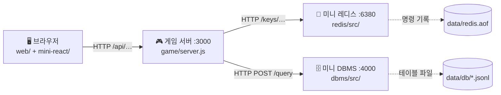

# 끝말잇기 + 미니 레디스 — 재구현 설명서

> 이 문서 하나만 보고 이 프로젝트를 처음부터 다시 만들 수 있게 쓴 설명서입니다.
> 레디스(Redis)를 처음 보는 사람을 기준으로, 개념 → 미니 레디스 → 게임 순서로 쌓아 올립니다.
> 발표용 요약은 [README.md](README.md) 에 있습니다. 숫자 · 이름 · 반환값은 2026-11-18 의 코드 기준입니다.

**범위**

| 부분 | 이 문서에서 | 비고 |
|---|---|---|
| 🧠 미니 레디스 (`redis/src/`) | 전부 (자료구조, 명령, 만료, HTTP API, 클라이언트, 캐시, AOF) | 이 프로젝트의 중심 |
| 🎮 게임 서버 (`game/`, `server.js`, `room.js`) | 전부 (규칙, 혼자 하기, 같이 하기, 로그인, API) | |
| 🖥️ 화면 (`web/`) | 화면 구성, 부르는 API, 시계와 저장 규칙 | 디자인(CSS)은 자유 |
| 🗄️ 미니 DBMS (`dbms/`) | 게임이 쓰는 약속(SQL, 응답 모양)만 | 내부 구현은 [dbms/README.md](dbms/README.md) |
| ⚛️ 미니 리액트 (`mini-react/`) | 화면이 쓰는 함수 목록만 | 별도 과제 |

**목차**

1. [먼저 알아 둘 개념](#1-먼저-알아-둘-개념) — **[1.7 왜 자바스크립트(Node.js)로 만들었나](#17-왜-자바스크립트nodejs로-만들었나)**
2. [전체 구조](#2-전체-구조)
3. [미니 레디스 만들기](#3-미니-레디스-만들기)
4. [미니 DBMS 와의 약속](#4-미니-dbms-와의-약속)
5. [게임 규칙 (값 그대로)](#5-게임-규칙-값-그대로)
6. [혼자 하기 서버](#6-혼자-하기-서버)
7. [같이 하기 서버](#7-같이-하기-서버)
8. [로그인](#8-로그인)
9. [게임 HTTP API](#9-게임-http-api)
10. [화면](#10-화면)
11. [단어 사전 파일](#11-단어-사전-파일)
12. [만드는 순서와 확인 목록](#12-만드는-순서와-확인-목록)
13. [상수 모음](#13-상수-모음)
14. [일부러 하지 않은 것](#14-일부러-하지-않은-것)

---

## 1. 먼저 알아 둘 개념

### 1.1 레디스가 하는 일

**레디스(Redis)** 는 데이터를 **메모리**에 두는 **키-값 저장소(Key-Value Store)** 입니다.

- **키-값**: 이름표(키, 문자열) 하나에 값 하나를 붙여 둡니다. `game:7` → `{ 목숨: 3, 점수: 120 }` 처럼요. 표(테이블)나 SQL 은 없고, "이 키의 값을 줘 / 이 키에 이 값을 넣어"만 합니다.
- **메모리에 둔다**: 파일에서 읽지 않으니 빠릅니다. 대신 프로세스가 꺼지면 사라집니다 (그래서 1.5 의 영속성이 따로 필요합니다).
- **서버로 따로 돈다**: 게임 서버와는 다른 프로그램이고, 게임 서버는 네트워크로 명령을 보냅니다. 그래서 게임 서버가 여러 개여도 같은 데이터를 함께 볼 수 있습니다.

이 프로젝트는 레디스를 직접 만든 **미니 레디스**를 씁니다. 실제 레디스와 같은 생각을 따르지만, 통신은 레디스 전용 프로토콜(RESP)이 아니라 HTTP + JSON 입니다.

### 1.2 TTL (만료)

키에 **보관 기간(TTL, Time To Live)** 을 붙일 수 있습니다. 기간이 지나면 그 키는 **없는 키**가 됩니다.

- 끝말잇기의 "한 차례 10초"는 이것 하나로 만듭니다: 차례가 시작되면 `turn` 키를 TTL 10초로 넣고, 단어가 왔을 때 그 키가 아직 있으면 시간 안, 없으면 시간 초과입니다.
- 남은 시간을 물으면 ms 로 답하고, **만료가 없는 키는 -1, 없는 키는 -2** 로 답합니다 (실제 레디스와 같은 규칙).

### 1.3 원자적 명령 (끼어들 수 없는 명령)

두 요청이 같은 데이터를 거의 동시에 바꾸면 결과가 꼬일 수 있습니다. 예: 판 번호가 7 일 때 두 요청이 동시에 7 을 읽고 둘 다 8 을 쓰면, 두 판이 같은 번호를 받습니다.

레디스는 **명령을 한 번에 하나씩** 실행합니다. 그래서 "읽고 → 계산하고 → 쓰기"를 **명령 하나**로 만들어 두면 중간에 끼어들 틈이 없습니다.

| 명령 | 하는 일 | 게임에서 |
|---|---|---|
| `incr` | 숫자를 1 더하고 결과를 돌려준다 | 판 번호 · 방 번호 발급, 로그인 실패 횟수 |
| `set … nx` | **키가 없을 때만** 저장한다. 저장했으면 성공 | 잠금(Lock): 성공한 요청 하나만 판을 바꾼다 |

### 1.4 캐시와 무효화

**캐시(Cache)** 는 느린 원본(여기서는 파일 기반 DBMS)의 결과를 빠른 곳(레디스)에 잠깐 복사해 두는 것입니다.

- **캐시 어사이드(Cache-Aside)**: 앱이 먼저 캐시를 보고(있으면 HIT), 없으면(MISS) 원본에서 읽어 캐시에 넣습니다.
- **무효화(Invalidation)**: 원본이 바뀌면 캐시의 복사본은 틀린 값이 됩니다. 그래서 원본을 바꿀 때 그 캐시 키를 지웁니다. 지우는 것을 잊어도 TTL 이 지나면 사라지게, 캐시에는 늘 TTL 을 같이 겁니다.

### 1.5 영속성 (AOF)

메모리의 데이터가 꺼질 때 사라지지 않게, **데이터를 바꾼 명령을 파일 끝에 한 줄씩** 적습니다. 이것을 **AOF(Append Only File)** 라고 합니다. 다시 켤 때 그 파일을 처음부터 다시 실행하면 꺼지기 직전 상태가 됩니다.

- 파일에 쓴 내용은 먼저 운영체제의 버퍼에 들어가고, `fsync` 를 불러야 디스크에 내려갑니다. 매번 부르면 느려서 **1초마다** 부릅니다 (그래서 강제 종료 때 최근 약 1초 분량은 잃을 수 있습니다).

### 1.6 이 게임에서 데이터를 나누는 기준

| 오래 둘 원본 → 🗄️ 미니 DBMS (파일) | 잠깐 쓰는 상태 → 🧠 미니 레디스 (메모리) |
|---|---|
| 단어 사전 (`words` 테이블) | 진행 중인 판 · 방의 상태 |
| 끝난 판의 기록 (`games` 테이블) | 차례 시간, 이번 라운드에 나온 단어, 잠금 |
| | 사전 조회 결과 캐시, 로그인 세션 |

### 1.7 왜 자바스크립트(Node.js)로 만들었나

이 프로젝트는 화면부터 저장소까지 **거의 전부 자바스크립트**입니다 (나머지는 HTML · CSS, 데이터인 JSON · 단어 목록). 미니 레디스를 C 로 만드는 경우가 많은데, 실제 Redis 가 C 로 쓰였기 때문입니다. 여기서는 아래 이유로 자바스크립트(Node.js)를 씁니다.

**핵심 이유 하나: 레디스가 일부러 만든 실행 방식을 Node.js 는 기본으로 갖고 있다**

실제 Redis 는 명령 처리를 **스레드 하나의 이벤트 루프**로 해서 잠금 없이 모든 명령을 원자적으로 만듭니다. Node.js 도 자바스크립트를 **스레드 하나**에서 실행하고, 네트워크 · 파일 기다림은 이벤트 루프가 맡습니다. 그래서 저장소 명령을 `await` 없는 동기 함수로만 쓰면, 1.3 의 "명령이 한 번에 하나씩"이 따로 만들지 않아도 지켜집니다 (3.2). C 로 같은 구조를 만들려면 `poll` · `epoll` 이벤트 루프와 논블로킹 소켓을 직접 짜거나, 스레드를 쓰면 잠금을 직접 걸어야 합니다.

| 이 프로젝트에 필요한 것 | Node.js 에서 | C 로 만든다면 |
|---|---|---|
| 명령이 한 번에 하나씩 (원자성) | JS 실행 스레드가 하나 → 동기 함수 = 끼어들 틈 없음 | 이벤트 루프를 직접 짜거나, 스레드 + 잠금 |
| 연결 수백 개를 동시에 받기 | `node:http` + 이벤트 루프 (비동기 I/O) | 소켓 · 논블로킹 · 연결별 버퍼를 직접 관리 |
| HTTP API (외부 프로그램이 쓰기 쉬운 API) | `node:http` 내장 | HTTP 해석기를 직접 짜거나 라이브러리 |
| 값 = 아무 JSON, AOF 한 줄 = JSON 한 줄 | `JSON.parse` · `JSON.stringify` 내장 | JSON 해석 · 직렬화를 직접 |
| 파일 끝에 쓰기 · `fsync` | `fs.writeSync` · `fs.fsyncSync` | `write` · `fsync` 시스템 호출 (같음) |
| 비밀번호 해시 · 토큰 | `node:crypto` 의 `scrypt` · `randomBytes` | OpenSSL 같은 라이브러리 |
| 여러 스레드 (미니 DBMS 의 스레드 풀) | `worker_threads` + `SharedArrayBuffer` + `Atomics` | `pthread` + 뮤텍스 |
| 화면 | 브라우저는 자바스크립트만 돈다 → 미니 리액트도 JS | 화면은 어차피 JS |
| 테스트 | `node:test` 내장 | 테스트 도구를 따로 |

그래서 이 프로젝트는 **외부 패키지가 0개**입니다. 이벤트 루프 · HTTP · JSON 같은 바탕은 언어에 맡기고, 과제의 핵심인 **해시 테이블 · 만료 · 원자적 명령 · 영속성 · 캐시 설계**에 시간을 씁니다. C 로 만드는 미니 레디스는 소켓 · 이벤트 루프 · 메모리 관리까지 직접 다루는 **시스템 프로그래밍 연습**에 무게가 있고, 이 프로젝트는 **레디스 기능을 실제 서비스(게임) 규칙에 붙여 보는 것**에 무게가 있습니다.

**한 언어로 묶여서 생기는 점**

- 브라우저 · 게임 서버 · 미니 레디스 · 미니 DBMS 가 같은 언어라, 한 사람이 화면에서 저장소까지 한 번에 따라 읽을 수 있다
- 규칙 함수(`game/rules.js`)를 게임 서버와 단어 분석 스크립트(`words/analyze.js`)가 같이 쓴다. 화면은 규칙 상수(난이도 · 등급 · 라운드 시간)를 따로 적어 두는데, 같은 언어라 옮겨 쓰기 쉽다
- 레디스에 넣는 값이 자바스크립트 객체 그대로(JSON)라, 판 상태를 따로 변환하지 않고 넣고 꺼낸다

**대신 잃는 것 (C 와 비교)**

| 잃는 것 | 이 코드에서 드러나는 곳 |
|---|---|
| 메모리를 직접 다루지 못함. 노드 하나가 JS 객체라 C 의 구조체보다 크고, 쓰레기 수집(GC) 때 잠깐 멈출 수 있음 | 해시 테이블 노드 `{ key, value, next }` |
| 숫자가 기본으로 64비트 실수 | 32비트 해시를 맞추려고 `Math.imul` 과 `>>> 0` 을 씀 (3.1) |
| 문자열이 UTF-16 | 해시를 `charCodeAt`(UTF-16 단위)으로 계산해서, UTF-8 바이트로 계산하는 C 구현과 **한글 키의 해시값이 다르다** (영문 키는 같다) |
| 속도 | 실제 Redis 와 비교하지는 않았다. 이 프로젝트의 성능 수치는 "캐시를 쓴 경우와 안 쓴 경우"의 차이뿐이다 |
| 리사이즈 중 멈춤 | 스레드가 하나라, 한 번에 옮기는 리사이즈 동안 다른 명령이 모두 기다린다 (14장) |

<sub>출처 (2026-11-18 확인): [Redis — What is Redis?](https://redis.io/tutorials/what-is-redis/) (명령 처리는 스레드 하나의 이벤트 루프, Redis 는 C 로 작성)</sub>

---

## 2. 전체 구조

### 2.1 프로그램 세 개



- 세 서버를 `server.js` 하나가 한 프로세스 안에서 켭니다. 그래도 게임 서버는 레디스 · DBMS 를 **HTTP 로만** 부릅니다 (외부 프로그램이 쓰는 방식 그대로).
- 기본 포트: 게임 3000, 레디스 6380, DBMS 4000 (`PORT`, `REDIS_PORT`, `DB_PORT` 환경 변수로 바꿈).
- 기본 주소는 `127.0.0.1` (이 PC 안에서만). `npm run room` 은 게임 서버만 `0.0.0.0` 으로 열어 같은 와이파이의 다른 기기가 들어오게 합니다.

### 2.2 폴더

```
word-chain/
├── server.js            세 서버를 켜는 진입점 (npm start)
├── room.js              HOST=0.0.0.0 으로 server.js 를 켜고 접속 주소를 출력 (npm run room)
├── redis/src/           미니 레디스
│   ├── hash-table.js    해시 테이블
│   ├── store.js         명령 · 만료 · 무효화 · 기록 알림
│   ├── api.js           HTTP API 서버
│   ├── client.js        HTTP 클라이언트 (연결 풀)
│   ├── cache.js         Cache-Aside (getOrLoad)
│   └── aof.js           명령 기록 파일 · 복구 · 줄이기
├── game/
│   ├── rules.js         규칙 (순수 함수)
│   ├── service.js       혼자 하기 (판 진행 · 사전 · 등급 표 · 순위)
│   ├── rooms.js         같이 하기 (방)
│   ├── auth.js          제작자 로그인
│   ├── server.js        게임 HTTP 서버 (화면 파일 + /api)
│   ├── db.js            미니 DBMS 클라이언트
│   ├── import-words.js  단어 파일 → DBMS
│   ├── set-admin.js     제작자 계정 만들기 (npm run admin)
│   └── schema.json      테이블 정의
├── web/                 index.html · app.js · api.js · style.css
├── mini-react/          화면 라이브러리
├── dbms/                미니 DBMS
├── words/               words.txt · finishers.txt · remove.txt · extra.txt
└── data/                실행 중 생기는 파일 (redis.aof, db/, words.sql)
```

### 2.3 켜지는 순서 (`server.js`)

1. **단어 넣기**: `words/*.txt` 에서 DBMS 에 아직 없는 단어만 골라 INSERT 문 파일(`data/words.sql`)을 만들고 DBMS 의 CLI 로 실행 (11장)
2. **미니 DBMS 서버** 켜기 (`maxRows: 100_000`)
3. **미니 레디스** 켜기: `data/redis.aof` 를 읽어 복구 → 주기 삭제 타이머 시작 → HTTP 서버
4. **게임 서버**: 레디스 · DBMS 클라이언트를 만들고 → 서비스 생성 → **단어 캐시 비우기**(`word:` · `first:`, 단어 파일이 바뀌었을 수 있음) → **등급 표 미리 세기**(비동기, 6.8) → 로그인(`admin.json`) → 방 서비스 → HTTP 서버
5. `SIGINT` · `SIGTERM` 을 받으면 타이머를 멈추고, 클라이언트 · 서버를 닫고, AOF 를 마지막으로 `fsync` 한 뒤 끝낸다

---

## 3. 미니 레디스 만들기

외부 라이브러리 없이 Node.js 내장 모듈(`node:http`, `node:fs`)만 씁니다.

### 3.1 해시 테이블 (`hash-table.js`)

`Map` / `Object` 를 저장소로 쓰지 않고 직접 만듭니다.

**구조**: 길이 `capacity` 의 배열 `buckets`. 칸(버킷) 하나는 노드 `{ key, value, next }` 로 된 연결 리스트의 머리이거나 `null`.

**해시 함수 FNV-1a (32비트)**

```js
function hashString(key) {
  let hash = 0x811c9dc5;                     // 시작값 (FNV offset basis)
  for (let i = 0; i < key.length; i++) {
    hash ^= key.charCodeAt(i);               // 글자 코드(UTF-16 단위)로 XOR
    hash = Math.imul(hash, 0x01000193);      // 16777619 를 곱한다 (32비트 정수 곱셈)
  }
  return hash >>> 0;                         // 부호 없는 32비트 정수로
}
```

**칸 번호**: `hashString(key) & (capacity - 1)`. capacity 를 늘 2의 거듭제곱으로 두므로 `% capacity` 와 같은 값입니다.

| 상수 | 값 |
|---|---|
| 처음 · 최소 capacity | 16 (생성자에 준 값은 16 이상의 2의 거듭제곱으로 올림) |
| 늘리는 기준 | 넣은 뒤 `size > capacity × 0.75` → capacity × 2 |
| 줄이는 기준 | 지운 뒤 `capacity > 16` 이고 `size < capacity × 0.125` → capacity ÷ 2 |

| 함수 | 동작 | 반환 |
|---|---|---|
| `set(key, value)` | 같은 키 노드가 있으면 값만 바꾼다. 없으면 새 노드를 **리스트 맨 앞**에 끼우고 size+1, 늘리는 기준 확인 | 새 키였으면 `true` |
| `get(key)` | 칸의 리스트를 따라가며 `node.key === key` 인 노드 | 값, 없으면 `undefined` |
| `has(key)` | | `true` / `false` |
| `delete(key)` | 앞 노드의 `next` 를 다음 노드로 (머리면 칸이 다음 노드를 가리키게), size-1, 줄이는 기준 확인 | 지웠으면 `true` |
| `clear()` | capacity 16 의 빈 배열로 | |
| `resize(n)` | 새 배열을 만들고 모든 노드의 칸 번호를 다시 계산해 옮긴다 (rehash). 옮길 때도 맨 앞에 끼운다 | |
| `entries()` | 0번 칸부터 차례로 `[key, value]` | 제너레이터 |
| `keys()` | `entries()` 의 키 배열 | 배열 |
| `scan(cursor, count)` | `cursor` 번 칸부터 칸 단위로 읽으며 모은 개수가 `count` 이상이 될 때까지. **칸 하나는 끝까지** 읽는다. `cursor` 가 capacity 이상이면 0 부터 | `{ cursor: 다음 칸 (끝까지 돌았으면 0), entries }` |
| `stats()` | | `{ capacity, size, loadFactor, usedBuckets, longestChain }` |

> 확인 값: `hashString('game:7') = 1180080784` (16칸이면 0번), `hashString('game:7:turn') = 2300311477` (5번), `hashString('word:기차') = 4115560709` (5번). 빈 테이블에 13개를 넣으면 capacity 가 32 가 된다.

### 3.2 저장소 (`store.js`)

해시 테이블을 **두 개** 씁니다.

- `data`: 키 → 값
- `expires`: 키 → 만료 시각(ms, `Date.now()` 기준 절대 시각). 만료를 건 키만 들어 있다

`createStore({ now = Date.now, onWrite = null })` 로 만듭니다. `now` 는 테스트에서 시간을 움직이려고 바꿔 끼우는 함수, `onWrite(record)` 는 데이터를 바꾼 명령의 기록을 받는 함수(AOF 가 씀)입니다.

**입력 검사** (어기면 `CommandError` → HTTP 400)

- 키: 비어 있지 않은 문자열, 512자 이하
- ttl: 0 보다 큰 유한한 숫자 (ms)
- `set` 의 값: `undefined` · `null` 은 안 됨 (JSON 으로 표현되는 값이면 무엇이든: 숫자, 문자열, 객체, 배열)

**살아 있는 키**: 모든 명령은 키를 보기 전에 `alive(key)` 를 부릅니다 = 만료 시각이 지났으면 그 자리에서 두 테이블에서 지우고(`stats.expired + 1`) "없음"으로 봅니다. 이것이 **지연 삭제(Lazy Expiration)** 입니다.

| 명령 | 동작 | 반환 | AOF 기록 |
|---|---|---|---|
| `set(key, value, { ttl, nx, xx })` | `nx`: 살아 있는 키가 있으면 저장 안 함. `xx`: 없으면 저장 안 함. 저장할 때 **ttl 이 없으면 걸려 있던 만료를 지운다** | 저장했으면 `true` | `{op:'set', key, value, expireAt}` (만료 없으면 `null`) |
| `get(key)` | 살아 있으면 값 (`stats.hits + 1`), 없으면 `stats.misses + 1` | 값 또는 `null` | 없음 |
| `del(...keys)` | 살아 있는 키만 지운다 | 지운 개수 | 지운 키마다 `{op:'del', key}` |
| `exists(key)` | | `true` / `false` | 없음 |
| `expire(key, ttl)` | 지금부터 ttl 뒤 만료 | 키가 없으면 `false` | `{op:'expire', key, expireAt}` |
| `persist(key)` | 만료를 없앤다 | 만료가 걸려 있었으면 `true` | `{op:'persist', key}` |
| `ttl(key)` | | 남은 ms, 만료 없음 `-1`, 키 없음 `-2` | 없음 |
| `incr(key, by = 1)` | 없는 키는 0 에서 시작. 정수가 아닌 값 · 정수가 아닌 `by` 는 오류. **만료 시각은 그대로 둔다** | 더한 뒤의 값 | `{op:'set', key, value: 결과, expireAt: 기존 값}` |
| `keys(prefix = '')` | `prefix` 로 시작하고 살아 있는 키 | 배열 (칸 번호 순) | 없음 |
| `delByPrefix(prefix)` | `keys(prefix)` 를 하나씩 `del` (prefix 는 비어 있으면 안 됨) | 지운 개수 | 키마다 `del` |
| `flushAll()` | 두 테이블을 비운다 | 지우기 전 키 수 | `{op:'flush'}` |
| `sweepExpired(sample = 20, rounds = 10)` | 주기 삭제 (3.3) | 지운 개수 | 없음 (지운 것은 만료라서) |
| `info()` | | `{ keys, keysWithTtl, hits, misses, expired, table: data.stats() }` | |
| `apply(record)` | 기록 하나를 다시 실행 (복구용, 3.6) | | 없음 |
| `snapshot()` | 살아 있는 키를 `set` 기록 목록으로 (파일 줄이기용) | 배열 | |

모든 명령은 **중간에 `await` 가 없는 동기 함수**입니다. Node.js 는 자바스크립트를 한 번에 하나씩 실행하므로 명령 하나가 끝나기 전에 다른 명령이 끼어들지 못합니다. 그래서 잠금 없이도 1.3 의 원자성이 지켜집니다.

### 3.3 주기 삭제 (Active Expiration)

아무도 다시 찾지 않는 키는 지연 삭제로는 영원히 남습니다. 그래서 타이머로 조금씩 훑어 지웁니다.

```
sweepExpired(sample = 20, rounds = 10):
  removed = 0
  반복 최대 rounds 번:
    { cursor, entries } = expires.scan(sweepCursor, sample)   ← 지난번에 멈춘 칸부터
    sweepCursor = cursor
    expired = entries 중 만료 시각이 지난 키를 지운 수
    removed += expired
    entries 가 비었거나 expired × 4 ≤ entries 수이면 멈춘다   ← 1/4 넘게 만료였을 때만 한 번 더
  return removed
```

`startSweeper(store, interval = 100)` 이 100ms 마다 부릅니다 (`setInterval` + `unref()`, 이 타이머 때문에 프로세스가 안 끝나는 일이 없게). 한 번에 전부 훑지 않는 이유는, 훑는 동안 다른 명령이 기다려야 하기 때문입니다.

### 3.4 HTTP API (`api.js`)

`createApiServer(store)` 가 `node:http` 서버를 만듭니다. 본문은 JSON, ttl 단위는 ms.

| 요청 | 본문 | 응답 |
|---|---|---|
| `GET /keys/:key` | | `200 { key, value, ttl }` · 없으면 `404` |
| `PUT /keys/:key` | `{ value, ttl?, nx?, xx? }` | `200 { ok: true }` · nx/xx 조건에 막히면 `409 { ok: false, error }` |
| `DELETE /keys/:key` | | `200 { deleted: 0 또는 1 }` |
| `POST /keys/:key/incr` | `{ by? }` | `200 { value }` |
| `POST /keys/:key/expire` | `{ ttl }` | `200 { ok: true }` · 없는 키 `404` |
| `DELETE /keys/:key/expire` | | `200 { ok: true 또는 false }` |
| `GET /keys?prefix=` | | `200 { keys: [...] }` |
| `DELETE /keys?prefix=` | | `200 { deleted: n }` |
| `POST /flush` | | `200 { deleted: n }` |
| `GET /info` | | `200 { keys, keysWithTtl, hits, misses, expired, table }` |

규칙

- 키는 경로에 `encodeURIComponent` 로 넣고, 서버는 `decodeURIComponent` 로 되돌린다 (잘못된 인코딩 → 400). 한글 · 공백 · `/` · `?` · `%` 가 든 키도 된다
- `GET` · `DELETE` 는 본문을 읽지 않는다. 나머지는 끝까지 읽어 JSON **객체**인지 확인 (빈 본문은 `{}`, 객체가 아니면 400, 1MB 넘으면 413)
- 본문을 다 읽은 뒤 명령을 **함수 호출 한 번**으로 실행한다 → 요청이 몰려도 명령은 한 줄로 선다
- 오류 응답은 `{ error: 메시지 }`. 상태: 400 인자 오류 · 404 없는 키 / 없는 경로 · 405 지원하지 않는 메서드 · 413 본문 초과 · 500 그 밖
- `listen(server, port, host = '127.0.0.1')` 은 `backlog: 4096` 으로 듣는다 (연결이 몰려도 운영체제가 거절하지 않게)

### 3.5 클라이언트 (`client.js`)

`createClient(baseUrl, { maxSockets = 32 })` → 메서드 이름 · 반환값이 저장소와 같은 객체 (모두 Promise).

- `http.Agent({ keepAlive: true, maxSockets: 32 })`: 연결을 최대 32개까지 다시 쓰고, 더 몰리면 줄을 세운다
- `get` → 404 면 `null` · `set` → 409 면 `false` · `ttl` 은 `GET /keys/:key` 로 물어 404 면 `-2`, 아니면 응답의 `ttl` · `expire` → 404 면 `false`
- 그 밖의 4xx · 5xx 는 `RedisError(status, message)` 를 던진다. 서버가 꺼져 있으면 연결 오류를 그대로 던진다
- `close()`: 연결 풀을 닫는다

### 3.6 캐시 (`cache.js`)

`createCache(redis, { ttl = 60_000 })` → `{ stats, getOrLoad, invalidate }`. `redis` 는 클라이언트든 저장소든 `get` · `set` · `del` 만 있으면 된다.

```
getOrLoad(key, loader):
  cached = safely(redis.get(key), 실패하면 null)
  cached 가 null 이 아니면 → stats.hits + 1, { value: cached, hit: true }
  stats.misses + 1
  loading 에 key 가 없으면:                       ← 같은 키를 동시에 놓친 요청은 하나의 loader 를 함께 기다린다
    job = (loader() 실행 → 값이 null/undefined 가 아니면 safely(redis.set(key, 값, { ttl })) → 값 돌려주기)
          끝나면 loading 에서 key 를 지운다
    loading.set(key, job)
  return { value: await loading.get(key), hit: false }

invalidate(key) = safely(redis.del(key), 실패하면 0)
safely(run, fallback): run 이 던지면 stats.errors + 1 하고 fallback   ← 레디스가 죽어도 원본으로 동작
```

`loading` 은 프로세스 안의 `Map` 입니다. 원본을 읽는 도중 무효화가 먼저 끝나면, 진행 중이던 loader 가 옛 값을 다시 캐시에 쓸 수 있습니다 (TTL 이 지나야 바로잡힘. 14장).

### 3.7 AOF (`aof.js`)

**기록 한 줄** = JSON 하나 + `\n`. 다섯 종류: `set` (key, value, expireAt) · `del` (key) · `expire` (key, expireAt) · `persist` (key) · `flush`.

```
{"op":"set","key":"game:7","value":{…},"expireAt":1794830089761}
{"op":"del","key":"game:7:lock"}
```

만료는 **절대 시각**(`expireAt`)으로 적습니다. "10초 뒤"로 적으면 다시 켤 때마다 10초가 새로 시작되기 때문입니다.

| 함수 | 동작 |
|---|---|
| `readRecords(path)` | 파일이 없으면 빈 목록. 줄마다 `JSON.parse`, 빈 줄은 건너뜀. **해석 안 되는 줄을 만나면 거기서 멈춤** → `{ records, broken: true }` |
| `openAof(path, { fsync = 'everysec' })` | 파일을 이어 쓰기(`'a'`)로 연다. `append(record)` = `writeSync` 한 줄. `'always'` 면 매번 `fsyncSync`, `'everysec'` 면 "쓴 것 있음" 표시만 하고 1초 타이머(`unref`)가 `fsyncSync`, `'no'` 는 운영체제에 맡김 |
| `rewrite(records)` | `path.tmp` 에 records 를 다 쓰고 `fsync` → 닫기 → 원래 파일 닫기(Windows 는 열린 파일을 바꿔치기 못함) → `rename(tmp, path)` → 다시 이어 쓰기로 열기 |
| `close()` | 타이머 멈춤 → 마지막 `fsync` → 닫기 |
| `openPersistentStore(path)` | ① `readRecords` ② 저장소를 만들되 **복구하는 동안은 기록하지 않게** 하고 `apply` 로 재생 ③ AOF 를 연다 ④ 기록이 하나라도 있었으면 `rewrite(store.snapshot())` 로 파일 줄이기 → `{ store, recovered, broken, compact, close }` |

**`apply(record)` 규칙** (복구용, 기록을 다시 남기지 않음)

- `set`: `expireAt` 이 이미 지났으면 그 키를 지우고 끝. 아니면 값을 넣고 `expireAt` 이 `null` 이면 만료를 지움, 있으면 그 시각으로
- `del`: 지움 · `expire`: 키가 있으면 만료 시각만 바꿈 · `persist`: 만료를 지움 · `flush`: 전부 지움 · 그 밖: 오류

---

## 4. 미니 DBMS 와의 약속

게임은 미니 DBMS 를 **HTTP 로 SQL 을 보내는 외부 프로그램**처럼 씁니다. 같은 약속을 지키면 다른 DBMS 로 바꿔도 됩니다.

### 4.1 테이블 (`game/schema.json`)

| 테이블 | 열 (타입) |
|---|---|
| `words` | `id` int · `word` text · `first` text (첫 글자) · `last` text (끝 글자) · `finisher` int (끝내기 단어면 1) · `removed` int (지운 기록이면 1) |
| `games` | `id` int · `player` text · `level` text · `turns` int · `result` text · `reason` text · `score` int |

- `id` 는 INSERT 때 DBMS 가 "지금까지 가장 큰 id + 1" 로 붙이고, `id` 에만 B+ 트리 인덱스가 있습니다
- **DELETE · UPDATE 가 없습니다.** 단어를 지울 때는 같은 단어를 `removed = 1` 로 한 줄 더 넣고, **같은 단어가 여러 줄이면 id 가 가장 큰 줄**을 따릅니다. 끝내기로 바꿀 때도 `finisher = 1` 인 줄을 더 넣습니다

### 4.2 HTTP

| 요청 | 응답 |
|---|---|
| `POST /query` ← `{ "sql": "…" }` | `200 { results: [문장별 결과], worker, elapsedMs }` · 오류는 4xx/5xx `{ error }` |
| `GET /tables` | `200 { tables: [{ table, columns, rows, indexHeight }] }` |
| `GET /stats` | 스레드 풀 상태 |

문장별 결과

- SELECT: `{ type: 'select', table, plan, columns: [열 이름], rows: [[값…]], rowCount, truncated? }`
  - `plan`: `INDEX_POINT` (`WHERE id = n`) · `INDEX_RANGE` (`id` 에 `>` `>=` `<` `<=`) · `FULL_SCAN` (그 밖)
  - 결과가 `maxRows`(게임은 100,000)를 넘으면 앞의 100,000 줄만 주고 `truncated: true`
- INSERT: `{ type: 'insert', table, rowCount, firstId, lastId }`

`game/db.js` 는 `query(sql)` 의 첫 결과를 돌려주고, SELECT 면 `rows` 를 열 이름 객체로 바꾼 `objects` 를 붙입니다. 문자열은 `quote(text)` = 작은따옴표로 감싸고 안의 `'` 를 `''` 로.

### 4.3 게임이 보내는 SQL 전부

| 때 | SQL | 읽는 방법 |
|---|---|---|
| 단어 하나 확인 (캐시 MISS) | `SELECT id, finisher, removed FROM words WHERE word = '기차'` | 전체 탐색 |
| 한 글자로 시작하는 단어 (캐시 MISS) | `SELECT id, word, finisher, removed FROM words WHERE first = '차'` | 전체 탐색 |
| 등급 표 세기 (6.8) | `SELECT id, word, first, removed FROM words WHERE id > 0` → 잘렸으면 마지막 id 부터 다시 | 범위 |
| 시작 단어 뽑기 | `SELECT word FROM words WHERE id = 163947` | 한 점 |
| 단어 등록 | `INSERT INTO words (word, first, last, finisher) VALUES ('기차', '기', '차', 0)` | |
| 단어 삭제 | `INSERT INTO words (word, first, last, finisher, removed) VALUES ('기차', '기', '차', 0, 1)` | |
| 판 · 방 기록 | `INSERT INTO games (player, level, turns, result, reason, score) VALUES (…)` | |
| 순위 (캐시 MISS) | `SELECT id, player, level, turns, result, score FROM games ORDER BY score DESC LIMIT 10` | 전체 탐색 |
| 기록 한 건 | `SELECT * FROM games WHERE id = 7` | 한 점 |
| 상태 화면 | `GET /tables`, `GET /stats` | |

---

## 5. 게임 규칙 (값 그대로)

규칙은 `game/rules.js` 에 서버 · 저장소를 모르는 **순수 함수**로 모아 둡니다.

### 5.1 단어와 잇기

- **단어**: `/^[가-힣]{2,}$/` — 한글 완성형 음절 2글자 이상. 공백 · 영문 · 숫자 · 자모(ㄱ) 불가
- **첫 글자 / 끝 글자**: `word[0]` / `word[word.length - 1]`
- **다음 단어가 시작할 글자** `nextStartChars(word)`: 끝 글자, 그리고 두음법칙으로 바뀐 글자가 있으면 그것도. 예: `요리` → `['리', '이']`, `기차` → `['차']`

**두음법칙 `dueum(char)`** — 한글 음절 = `0xAC00 + (초성 × 21 + 중성) × 28 + 종성`. 초성 번호 ㄴ=2, ㄹ=5, ㅇ=11

| 초성 | 중성 | 바뀐 초성 | 예 |
|---|---|---|---|
| ㄹ | ㅑ ㅕ ㅖ ㅛ ㅠ ㅣ (중성 번호 2, 6, 7, 12, 17, 20) | ㅇ | 리→이, 력→역, 례→예, 룡→용, 류→유, 량→양 |
| ㄹ | ㅏ ㅐ ㅗ ㅚ ㅜ ㅡ (0, 1, 8, 11, 13, 18) | ㄴ | 래→내, 락→낙, 로→노, 뢰→뇌, 루→누, 름→늠 |
| ㄴ | ㅕ ㅛ ㅠ ㅣ (6, 12, 17, 20) | ㅇ | 녀→여, 뇨→요, 뉴→유, 니→이, 념→염 |

종성은 그대로 둡니다. 그 밖의 글자(한글 음절이 아닌 글자 포함)는 `null`.

### 5.2 거절 규칙 `rejectReason(word, { need, used, known, firstKill })`

위에서부터 처음 걸리는 하나를 돌려주고, 다 통과하면 `null`.

| 순서 | 코드 | 조건 | 메시지 |
|---|---|---|---|
| 1 | `format` | 단어 형식이 아님 | 한글 2글자 이상으로 입력하세요 |
| 2 | `start` | `need` 가 있고 첫 글자가 그 안에 없음 | 'X' 또는 'Y'(으)로 시작해야 합니다 |
| 3 | `used` | 이번 라운드에 이미 나옴 | 'W'은(는) 이번 라운드에 이미 나온 단어입니다 |
| 4 | `unknown` | 사전에 없음 | 'W'은(는) 등록되지 않은 단어입니다 |
| 5 | `first-kill` | 라운드의 첫 단어인데 한방 단어 | 라운드의 첫 단어로는 한방 단어를 낼 수 없습니다 ('W') |

서버는 이 순서대로 확인해서, **앞 조건을 통과한 단어만** 사전을 찾아보고(4), 사전에 있는 단어만 이을 단어를 셉니다(5).

### 5.3 등급과 점수

**등급** = 낸 단어 다음에 이을 수 있는 단어 수(`options`). 끝 글자와 두음법칙 글자로 시작하는 **사전 전체**의 단어 수이고, 이번 라운드에 이미 나온 단어도 셉니다.

| 등급 (코드) | options | 등급 점수 |
|---|---|---:|
| 💀 한방 (`kill`) | 0 | 2,000 |
| 🔥 공격 (`attack`) | 1 ~ 10 | 1,000 |
| ⚡ 까다로움 (`tricky`) | 11 ~ 100 | 500 |
| 🙂 보통 (`normal`) | 101 ~ 1,000 | 250 |
| 🌱 넉넉 (`easy`) | 1,001 이상 | 100 |

**글자 수 점수** `letterPoints(n)`: `n < 10` 이면 `round(300 × (n / 10)²)`, 아니면 `300 + (n − 10) × 60`. → 2글자 12 · 3글자 27 · 5글자 75 · 9글자 243 · 10글자 300 · 11글자 360 · 12글자 420

**한 단어의 점수** = 등급 점수 + 글자 수 점수. 시작 단어는 0점.

### 5.4 판 · 라운드 · 시간 · 목숨

| 규칙 | 값 |
|---|---|
| 한 차례 제한 시간 | 10초 |
| 라운드 | 새 시작 단어부터 **누군가 목숨을 잃을 때까지** |
| 라운드 시간 | 판을 시작할 때 10 · 30 · 60 · 90 · 120 · 150초 중 하나 (기본 60). 끄투의 선택지 |
| 라운드 시간이 주는 때 | 플레이어 차례에 쓴 시간만큼. 상대는 바로 받아치므로 줄지 않음 |
| 실제 차례 마감 | `min(10초, 라운드 남은 시간)`. 라운드 시간 때문에 먼저 끝나면 이유가 `round-time` |
| 목숨 | 판을 시작할 때 1 ~ 5개 (기본 3), 플레이어와 상대가 같은 수 |
| 목숨을 잃는 때 | 시간 초과(`timeout` · `round-time`), 이을 단어가 하나도 없는 단어를 받음(`no-word`), 상대가 낼 단어가 없음(`computer-stuck`) |
| 틀린 단어 | 목숨은 그대로, 시간만 흐름 |
| 판이 끝나는 때 | 어느 한쪽 목숨이 0, 또는 포기(`give-up`) |
| 라운드가 바뀔 때 | 나온 단어를 모두 비움 (지난 라운드 단어를 다시 낼 수 있음), 라운드 시간 다시 채움 |
| 선공 | 첫 라운드는 50 : 50 무작위, 그 뒤로는 **목숨을 잃은 쪽**이 먼저 |
| 첫 턴 한방 금지 | 라운드의 첫 단어는 한방(options 0) · 끝내기 단어일 수 없음. 상대도 첫 수에서는 한방을 빼고 고름 |
| 시작 단어 | 사전에서 무작위로 뽑은 2 ~ 3글자 단어 (6.4). 못 뽑으면 아무 단어로 시작 |

### 5.5 상대(컴퓨터)가 단어를 고르는 법 `pickWord(candidates, level, random, gradeOfWord)`

난이도마다 **한 단계 확률** p 가 있습니다.

| 난이도 (코드) | 아주 쉬움 (`easy`) | 쉬움 (`mild`) | 보통 (`normal`) | 어려움 (`tough`) | 절대적 (`hard`) |
|---|---:|---:|---:|---:|---:|
| p | 0 | 0.25 | 0.5 | 0.75 | 1 |

```
pickWord(candidates, level, random, gradeOfWord = 모두 'easy'):
  p = 난이도의 확률 (모르는 난이도는 normal)
  등급 묶음 5개를 한방 → 공격 → 까다로움 → 보통 → 넉넉 순서로 만든다
  후보마다: p 가 0 이고 끝내기 단어면 버린다
           끝내기 단어면 한방 묶음, 아니면 gradeOfWord(단어) 묶음에 넣는다
  filled = 후보가 있는 묶음만 (순서 유지)
  filled 의 마지막 하나를 뺀 각 묶음에 대해: random() < p 이면 그 묶음에서 무작위 하나를 낸다
  다 빗나가면 filled 의 마지막(가장 약한) 묶음에서 무작위 하나. filled 가 비었으면 null
  (무작위 하나 = list[floor(random() × 길이)])
```

다섯 등급이 다 있을 때 등급별로 낼 비율(계산값)은 p, (1−p)p, (1−p)²p, (1−p)³p, (1−p)⁴ 입니다. 보통이면 50 · 25 · 12.5 · 6.25 · 6.25%.

---

## 6. 혼자 하기 서버

`createGameService({ redis, db, turnMs = 10_000, random = Math.random, wordFiles = null, randomStart = true, lives = 3, secondMs = 1000, coin = random })` (`game/service.js`). `secondMs` 는 라운드 시간 1초의 길이(테스트에서 줄임), `coin` 은 첫 선공을 정하는 난수입니다.

### 6.1 레디스 키

| 키 | 값 | TTL | 쓰는 곳 |
|---|---|---|---|
| `game:<번호>` | 판 상태 (6.2) | 30분, 끝난 판 10분 | 매 요청 |
| `game:<번호>:turn` | `1` | `min(10초, 라운드 남은 시간)` | 사라지면 시간 초과 |
| `game:<번호>:used:<단어>` | `1` | 30분 | 이번 라운드에 나온 단어. 새 라운드 · 판 끝에 `delByPrefix` |
| `game:<번호>:lock` | `1` | 5초, `nx` | 한 판을 한 번에 한 요청만 |
| `game:seq` | 정수 | 없음 | `incr` 로 판 번호 |
| `stats:games` | 정수 | 없음 | 끝난 판 수 |
| `word:<단어>` | `{ known, finisher }` | 60초 | 사전 확인 캐시 |
| `first:<글자>` | `[{ word, finisher }…]` | 60초 | 그 글자로 시작하는 단어 캐시 |
| `ranking` | 순위 10개 | 5초 | 순위 캐시 |

### 6.2 판 상태 (`game:<번호>` 의 값)

| 필드 | 뜻 |
|---|---|
| `id` · `player` · `level` | 판 번호 · 이름(앞뒤 공백 뺀 12자, 비면 '손님') · 난이도 |
| `round` · `roundMs` · `roundLeftMs` | 라운드 시간(초) · 그것을 ms 로 · 이번 라운드에 남은 ms |
| `roundNo` | 몇 번째 라운드 (1 부터) |
| `turnLimitMs` | 지금 차례 키에 건 TTL |
| `status` · `result` · `reason` | `'playing'` / `'over'` · `'win'` / `'lose'` / `null` · 끝난 이유 |
| `need` | 다음 단어가 시작해야 할 글자 배열, 없으면 `null` (아무 단어) |
| `turns` | 받아들인 단어 수 (양쪽 합) |
| `lives` · `livesStart` | `{ player, computer }` · 처음 목숨 수 |
| `score` | `{ player, computer }` |
| `firstMove` · `starter` | 이번 라운드의 첫 수가 아직인가 · 이번 라운드를 먼저 낸 쪽 |
| `history` | 기록 목록 (아래) |
| `recordId` | 끝났을 때 DBMS 의 `games` id |

`history` 의 한 줄

- 단어: `{ by: 'start' | 'player' | 'computer', word, options, grade, points }` (상대는 `finisher` 도)
- 목숨: `{ by: 'life', who: 'player' | 'computer', reason, left }`

**화면에 보낼 때 더하는 값** (`view`): `remainingMs` = 차례 키의 남은 TTL(실제 마감까지), `turnRemainingMs` = `turnMs − (turnLimitMs − remainingMs)` (차례 막대, 차례마다 10초로 다시 참), `roundRemainingMs` = `roundLeftMs − (turnLimitMs − remainingMs)`, `turnMs`. 끝난 판이면 셋 다 0.

**trace**: 응답마다 붙는 "값을 어디서 가져왔나" 목록. 한 줄 = `{ label, key, source: 'cache' | 'db' | 'redis', plan, ms }`.

### 6.3 사전 찾기 (캐시를 거침)

```
findWord(word):   ← 캐시를 거치지 않는 원본 조회
  SELECT id, finisher, removed FROM words WHERE word = '…'
  latest = id 가 가장 큰 줄
  known = latest 가 있고 removed ≠ 1,  finisher = known 이고 latest.finisher = 1

lookup(word) = getOrLoad('word:' + word, findWord)

wordsStartingWith(char) = getOrLoad('first:' + char, …):
  SELECT id, word, finisher, removed FROM words WHERE first = '…'
  id 순으로 정렬해 같은 단어는 마지막 줄만 남기고, removed = 1 인 단어는 뺀다 → [{ word, finisher }]

continuations(word, used):
  all = nextStartChars(word) 의 글자마다 wordsStartingWith 를 이어 붙인 것
  return { total: all 의 개수, open: all 중 used 에 없는 것 }
```

`total` 이 등급의 `options` 이고, `open` 이 실제로 낼 수 있는 후보입니다.

### 6.4 판 열기 · 라운드 열기

```
start({ player, level, round, lives }):
  값 고르기: level 이 5개 중 하나가 아니면 'normal', round 가 6개 중 하나가 아니면 60, lives 가 1~5 정수가 아니면 기본값
  id = INCR game:seq
  state = { … roundNo: 1, status: 'playing', history: [] … }
  openRound(state, 빈 집합, coin() < 0.5 ? 'player' : 'computer')

pickStartWord(used):
  rows = DBMS 의 words 레코드 수 (GET /tables)
  최대 30번: id = 1 + floor(random() × rows) → SELECT word FROM words WHERE id = …
    2~3글자이고, used 에 없고, lookup 으로 살아 있고, continuations 의 open 이 1개 이상이면 → { word, total }
  못 찾으면 null

openRound(state, used, starter):
  first = randomStart 면 pickStartWord(used)
  need = null, roundLeftMs = roundMs, firstMove = true, starter 기록
  first 가 있으면: history 에 { by: 'start', … points: 0 }, need = nextStartChars(first), SET game:<번호>:used:<first>
  starter 가 상대면:
    시작 단어가 있으면 그 뒤를 잇는 후보로 상대의 한 수 (6.6)
    없으면 pickStartWord 로 고른 단어를 상대가 낸 것으로 기록
    낼 단어가 없으면 → loseLife(상대, 'computer-stuck')
    상대가 낸 단어의 open 이 0 이면 → loseLife(플레이어, 'no-word')
  turnLimit: turnLimitMs = max(1, min(turnMs, roundLeftMs))
  SET game:<번호> (30분) → SET game:<번호>:turn 1 (ttl turnLimitMs)
```

### 6.5 단어 내기 `play(id, word)`

```
withLock(id):                                     ← SET game:<번호>:lock 1 nx ttl 5초. 실패하면 409. 끝나면 finally DEL
  state = GET game:<번호>  (없으면 404, 끝난 판이면 409)
  remaining = TTL game:<번호>:turn
  remaining = -2 → loseLife(플레이어, turnLimitMs < turnMs ? 'round-time' : 'timeout'), 거절 'timeout'
  valid · startsRight · used(GET …:used:<단어>) 를 보고, 셋 다 통과하면 lookup
  rejectReason(word, { need, used, known }) → 거절이면 판을 바꾸지 않고 돌려준다
  usedWords = KEYS game:<번호>:used: + 이 단어
  mine = continuations(word, usedWords)
  firstMove 이고 (mine.total = 0 또는 끝내기 단어) → 거절 'first-kill'
  roundLeftMs -= (turnLimitMs − remaining)                     ← 이번 차례에 쓴 시간
  SET …:used:<단어>, history · 점수 · turns 에 반영, firstMove = false
  상대의 한 수 (6.6). 없으면 → loseLife(상대, 'computer-stuck')
  상대 단어의 open 이 0 → loseLife(플레이어, 'no-word')
  turnLimit → SET game:<번호> → SET …:turn
응답: { accepted, reject: { code, message } | null, computer: { word, finisher } | null, game: view(state), trace }
```

`get(id)`: 끝난 판이거나 `TTL turn ≠ -2` 면 그대로 돌려줌. `-2` 면 잠금을 잡고 다시 읽어, 여전히 진행 중이고 `-2` 면 플레이어가 목숨을 잃음 (같은 시간 초과로 두 번 잃지 않게).
`giveUp(id)`: 잠금 → 진행 중이면 `finish(lose, 'give-up')`.

### 6.6 상대의 한 수

```
computerMove(state, usedWords, candidates):
  counts = 등급 표 (6.8). 못 만들었으면 등급 없이 (끝내기 단어만 한방으로)
  grader(단어) = gradeOf( nextStartChars(단어) 의 글자마다 counts 를 더한 값 )
  firstMove 면 후보에서 끝내기 단어와 grader 가 한방인 단어를 뺀다
  reply = pickWord(후보, level, random, grader)
  reply 가 있으면: SET …:used:<reply>, theirs = continuations(reply, usedWords + reply),
                    history 에 { by: 'computer', …, finisher }, 상대 점수, turns, need = nextStartChars(reply), firstMove = false
```

### 6.7 목숨 잃기 · 판 끝내기

```
loseLife(state, who, reason):
  lives[who] − 1, history 에 { by: 'life', who, reason, left }
  lives[who] ≤ 0 → finish(who 가 플레이어면 'lose', 아니면 'win', reason)
  roundNo + 1, delByPrefix game:<번호>:used:        ← 라운드마다 나온 단어 비우기
  openRound(state, 빈 집합, who)                      ← 진 쪽이 먼저

finish(state, result, reason):
  status = 'over', INSERT INTO games (player, level, turns, result, reason, 플레이어 점수) → recordId
  DEL …:turn, delByPrefix …:used:, DEL ranking, INCR stats:games, SET game:<번호> (10분)
```

### 6.8 등급 표 (상대가 후보 등급을 빨리 알기 위한 메모리 표)

후보가 수백 개이고 끝 글자도 제각각이라, 후보마다 `first:<글자>` 를 부르면 한 차례에 DBMS 를 수백 번 부를 수 있습니다. 그래서 게임 서버 메모리에 **첫 글자 → 살아 있는 단어 수** 표를 한 번 만들어 둡니다.

- 만들기: `SELECT id, word, first, removed FROM words WHERE id > 0` → 결과가 잘렸으면(`truncated`) 받은 마지막 id 로 `WHERE id > 마지막` 을 다시. 같은 단어는 id 가 가장 큰 줄만 남기고, `removed = 1` 은 빼고, `first` 별로 센다 (34만 단어에서 약 1.5초, 2026-11-18 이 PC 의 VM 에서 잰 값)
- 서버를 켤 때 미리 만든다. 실패하면 첫 차례에 다시 시도하고, 그래도 안 되면 등급 없이 고른다
- 단어 등록 · 삭제와 같은 줄(6.9 의 `registering`)에 세워서, 세는 도중의 등록이 빠지거나 두 번 세지지 않게 한다
- 등록하면 `+1`(끝내기로 바꾸기만 한 단어는 그대로), 삭제하면 `−1`. 아직 다 세지 않았으면 고치지 않는다 (나중에 셀 때 반영됨)
- `clearWordCache()` 를 부르면 표도 버리고 다음에 다시 센다

### 6.9 단어 등록 · 삭제 · 찾기 · 순위

- 등록 · 삭제는 `registering` 이라는 Promise 줄에 하나씩 세워 실행한다 ("있는지 확인 → INSERT" 사이에 다른 등록이 끼어들지 않게)
- **등록** `register(word, finisher)`: 형식 검사(400) → `findWord` → 이미 있고 (끝내기이거나 일반으로 다시 등록) 이면 `added: false` → INSERT → `word:<단어>`, `first:<첫 글자>` 캐시 무효화 → 등급 표 고치기 → 단어 파일(`words.txt` 또는 `finishers.txt`) 끝에 한 줄 추가, `remove.txt` 에서 그 줄 삭제
- **삭제** `remove(word)`: 형식 검사 → 없는 단어면 `removed: false` → `removed = 1` 로 INSERT → 같은 두 캐시 무효화 → 등급 표 −1 → `remove.txt` 끝에 추가
- **찾기** `words(prefix)`: 한글 1~20자. `first:<prefix 첫 글자>` 캐시에서 `startsWith(prefix)` 로 거름
- **순위** `ranking()`: `ranking` 키로 5초 캐시. 원본은 4.3 의 순위 SQL
- **기록** `record(id)` · **상태** `status()`: 레디스 `info`, DBMS `/tables` · `/stats`, 캐시 적중 통계

---

## 7. 같이 하기 서버

`createRoomService({ redis, db, dictionary, turnMs = 10_000, secondMs = 1000, random = Math.random, randomStart = true })` (`game/rooms.js`). `dictionary` 는 혼자 하기 서비스가 내주는 `{ lookup, continuations, pickStartWord }` 라서 **사전 · 캐시를 같이 씁니다.**

### 7.1 키와 방 상태

| 키 | 값 | TTL |
|---|---|---|
| `room:<번호>` | 방 상태 | 30분 (바뀔 때마다 다시), 끝난 방 10분 |
| `room:<번호>:turn` | 지금 차례인 사람의 시간 | `min(10초, 라운드 남은 시간)` |
| `room:<번호>:used:<단어>` | 이번 라운드에 나온 단어 | 30분, 새 라운드에 `delByPrefix` |
| `room:<번호>:lock` | 잠금 | 5초, `nx` |
| `room:seq` | 방 번호 | 없음 |

방 상태: `id`, `name`(20자, 비면 "방장 이름의 방"), `status`(`'waiting'` · `'playing'` · `'over'`), `settings`(`{ lives: 1~5, round }`), `host`(방장 pid), `nextPid`, `players`(`[{ pid, name, token, lives, score }]`, 최대 4명), `turn`(지금 차례 pid), `starter`, `need`, `history`, `turns`, `roundNo`, `roundMs`, `roundLeftMs`, `turnLimitMs`, `firstMove`, `winners`(pid 배열), `reason`.

- 사람마다 **토큰**(무작위 16바이트 hex)을 준다. 요청은 `X-Room-Token` 머리말로 누구인지 알린다. 응답에서는 토큰을 빼고, 받는 사람의 pid 를 `me` 로 붙인다
- 이름을 비우면 `'손님' + pid`
- `history` 는 응답에 마지막 80줄만. 단어 줄은 `{ by: 'start' | 'player', pid, word, options, grade, points }`, 목숨 줄은 `{ by: 'life', pid, reason, left }`

### 7.2 동작

| 함수 | 잠금 | 동작 |
|---|---|---|
| `list()` | | `KEYS room:` 중 `room:<숫자>` 만, 끝나지 않은 방을 새 방부터 `{ id, name, status, players: [이름], max: 4, settings }` |
| `create({ name, player, lives, round })` | | `INCR room:seq`, 만든 사람 pid 1 · 방장 → `{ room, token }` |
| `join(id, { player })` | ✓ | 기다리는 방만(아니면 409), 4명이면 409 → `{ room, token }` |
| `start(id, token)` | ✓ | 방장만(403), 2명 이상(409). 모두 목숨 = 설정값, 점수 0, roundNo 1, **선공 = 자리 중 무작위 한 명** → 라운드 열기 |
| `play(id, token, word)` | ✓ | 시간 초과면 반영 후 거절. **내 차례가 아니면 `not-your-turn`**. 판정 · 첫 턴 한방 금지 · 라운드 시간 빼기는 혼자 하기와 같음. 받으면 점수 더하고 **다음 차례 = 자리 순서로 다음, 목숨이 남은 사람** |
| `get(id, token)` | 시간 초과 반영 때만 | `TTL turn = -2` 면 잠금을 잡고 그때 차례인 사람이 목숨 −1. **이미 잠겨 있으면 409 대신 지금 상태** |
| `leave(id, token)` | ✓ | 기다리는 중: 자리 빼기, 방장이면 다음 사람이 방장, 아무도 없으면 방 키 삭제. 판 중: 목숨 0 으로 빠짐(`left`), 한 사람만 남으면 끝 |

- 목숨을 잃으면: 남은 사람이 1명 이하이면 끝(`last-one`). 아니면 roundNo + 1, 나온 단어를 비우고, **그 사람(목숨이 0 이면 자리 순서로 다음 사람)** 이 먼저인 새 라운드
- 이을 단어가 없는 단어를 받은 사람은 따로 처리하지 않는다. 시간이 다 돼서 목숨을 잃는다
- 끝나면 `winners` = 목숨이 남은 사람, 사람마다 `games` 에 한 줄(`level = 'room'`, 이긴 사람 `'win'`), `DEL ranking`, 차례 · 나온 단어 키 삭제, 방 상태 10분 보관

---

## 8. 로그인

단어 등록 · 삭제만 제작자 로그인이 필요합니다 (`game/auth.js`). 게임은 로그인 없이 합니다.

- **계정 파일** `admin.json`: `{ id, salt, hash }`. `npm run admin` 이 아이디(`/^[A-Za-z0-9_-]{3,20}$/`)와 비밀번호(8자 이상, 두 번 입력)를 받아 만든다. `hash = scrypt(비밀번호, salt, 32바이트)` 의 hex, salt 는 무작위 16바이트 hex
- **로그인** `login(id, password, 접속 주소)`
  1. 계정 파일이 없으면 503
  2. `GET login:fail:<주소>` 가 5 이상이면 429
  3. 아이디 · 비밀번호 해시를 SHA-256 으로 바꾼 뒤 `timingSafeEqual` 로 비교 (아이디가 틀려도 해시 계산을 똑같이 해서 응답 시간으로 알 수 없게)
  4. 틀리면 `INCR login:fail:<주소>`, 결과가 1 이면 `EXPIRE` 1분 → 401
  5. 맞으면 실패 키 삭제, 토큰 = 무작위 32바이트 hex(64자), `SET session:<토큰> { id } ttl 30분` → `{ token, id, expiresInMs }`
- **확인** `session(token)`: 64자 hex 가 아니면 `null`. `GET session:<토큰>` → `{ id, remainingMs }`
- 요청은 `Authorization: Bearer <토큰>`. 로그아웃은 `DEL session:<토큰>`

---

## 9. 게임 HTTP API

`createGameServer({ service, auth, rooms, webDir, libDir })` (`game/server.js`).

- `/api/` 가 아닌 GET · HEAD: `web/` 아래 파일 (`/` 는 `index.html`), `/mini-react/…` 는 미니 리액트 폴더. 폴더 밖 경로 · 모르는 확장자 · 없는 파일은 404. `cache-control: no-store`
- 본문은 JSON 객체(최대 64KB, 넘으면 413, 객체가 아니면 400)
- 오류는 `{ error }`, 상태는 서비스가 던진 값(400 · 401 · 403 · 404 · 405 · 409 · 413 · 429 · 503), 그 밖은 500

| 메서드 · 주소 | 본문 / 머리말 | 응답 |
|---|---|---|
| `POST /api/games` | `{ player, level, round, lives }` | `{ game, trace }` |
| `GET /api/games/:id` | | `{ game, trace }` (시간 초과면 여기서 반영) |
| `POST /api/games/:id/words` | `{ word }` | `{ accepted, reject, computer, game, trace }` |
| `POST /api/games/:id/giveup` | | `{ game, trace }` |
| `GET /api/words?first=기차` | | `{ first, words: [{ word, finisher }], trace }` |
| `POST /api/words` | `{ word, finisher }` + Bearer | `{ added, word, finisher, id?, invalidated?, message }` |
| `DELETE /api/words` | `{ word }` + Bearer | `{ removed, word, id?, invalidated?, message }` |
| `POST /api/login` | `{ id, password }` | `{ token, id, expiresInMs }` |
| `POST /api/logout` | Bearer | `{ ok: true }` |
| `GET /api/session` | Bearer | `{ loggedIn, id, remainingMs, configured }` |
| `GET /api/ranking` | | `{ ranking: [{ id, player, level, turns, result, score }], trace }` |
| `GET /api/records/:id` | | `{ record, trace }` |
| `GET /api/status` | | `{ redis, tables, pool, cache }` |
| `GET` · `POST /api/rooms` | 만들기: `{ name, player, lives, round }` | `{ rooms }` · `{ room, token }` |
| `GET /api/rooms/:id` | `X-Room-Token` (없어도 됨) | `{ room }` |
| `POST /api/rooms/:id/join` | `{ player }` | `{ room, token }` |
| `POST /api/rooms/:id/start` · `/leave` | `X-Room-Token` | `{ room }` · `{ left, room }` |
| `POST /api/rooms/:id/words` | `{ word }` + `X-Room-Token` | `{ accepted, reject, room }` |

---

## 10. 화면

`web/index.html` 의 `<div id="app">` 을 미니 리액트가 그립니다. 컴포넌트는 `web/app.js`, API 호출은 `web/api.js`.

**미니 리액트에서 쓰는 함수** (같은 이름 · 같은 동작이면 React 등으로 바꿔도 됨)

| 함수 | 동작 |
|---|---|
| `h(type, props, ...children)` | 가상 노드. `type` 은 태그 이름 또는 함수 컴포넌트. `on…` 으로 시작하는 함수 prop 은 이벤트(미니 리액트는 **click 만** 위임) |
| `useState` · `useEffect(fn, deps)` · `useMemo` | 훅. 루트 컴포넌트 `App` 에서만 쓴다 |
| `batch(fn)` | 안의 setState 여러 개를 한 번만 다시 그린다 |
| `createRoot(container)` · `containerToVdom` | 루트 만들기 · 처음 DOM 을 가상 노드로 |

**탭 네 개**: 게임(혼자 하기) · 같이 하기 · 단어 등록 · 기록

| 화면 | 하는 일 |
|---|---|
| 게임 | 이름 · 난이도 5개 · 라운드 시간 6개 · 목숨 1~5 를 고르고 시작. 가운데 큰 상자에 마지막 단어(끝 글자에 형광펜), 막대 두 개(차례 · 라운드), 입력 칸, 낸 단어 목록(등급 색 · 이모지 · 점수), 오른쪽 "방금 일어난 일"(trace) |
| 같이 하기 | 방 밖: 내 이름, 방 만들기(목숨 · 라운드 시간), 열린 방 목록. 방 안: 사람 목록(차례 형광펜, 빠진 사람 흐리게), 마지막 단어, 막대 두 개, 내 차례일 때만 입력 칸, 나가기(누르면 경고 상자 → 나가기 / 취소, 끝난 방은 바로) |
| 단어 등록 | 로그인, 단어 등록 · 끝내기로 등록 · 삭제, 글자로 찾기(앞 300개만 보임) |
| 기록 | 순위 10개, 레디스 · DBMS 상태 |

**시계와 조회 규칙**

- 혼자 하기: 0.1초마다 화면 시각을 갱신, 마감(`응답을 받은 시각 + remainingMs`) + 0.15초가 지나면 `GET /api/games/:id` (서버가 시간 초과를 반영)
- 차례 막대 = `turnRemainingMs − (remainingMs − 지금 남은 시간)`, 라운드 막대 = `roundRemainingMs − (remainingMs − 지금 남은 시간)`
- 같이 하기: 방 밖이면 2초마다 방 목록, 방 안이면 0.1초 시계 + 0.5초마다 `GET /api/rooms/:id`. 404 면 목록으로
- Enter 키: 입력 칸의 `data-enter` 가 가리키는 버튼 id 를 누른 것으로

**브라우저에 기억하는 것**

| 저장소 | 키 | 값 | 이유 |
|---|---|---|---|
| `localStorage` | `name` | 마지막으로 쓴 이름 | 판이 끝나 돌아와도 이름 칸을 채움 |
| `sessionStorage` | `admin` | `{ token, id }` | 새로고침해도 로그인 유지 (서버에 아직 살아 있는지 물어봄) |
| `sessionStorage` | `room` | `{ id, token }` | 새로고침해도 방 자리 유지 |

모든 저장소 읽기 · 쓰기는 `try/catch` 로 감싼다 (막혀 있어도 게임은 됨).

---

## 11. 단어 사전 파일

| 파일 | 형식 |
|---|---|
| `words/words.txt` | 한 줄에 단어 하나 (일반 단어). 빈 줄 · `#` 으로 시작하는 줄은 무시, 앞의 BOM 제거 |
| `words/finishers.txt` | 끝내기 단어. 두 파일에 다 있으면 끝내기로 본다 |
| `words/remove.txt` | 삭제 목록. 여기 있는 단어는 넣지 않고, DBMS 에 살아 있으면 `removed = 1` 줄을 넣는다 |

`importWords` (`game/import-words.js`, 서버를 켤 때 자동)

1. 세 파일을 읽고 형식(5.1)에 맞지 않는 줄은 따로 모은다
2. DBMS 엔진을 직접 열어 `SELECT id, word, finisher, removed FROM words` 로 지금 상태를 읽는다
3. 넣을 것: 없거나 지워진 단어, 일반 → 끝내기로 바뀐 단어(`promoted`), 삭제 목록인데 살아 있는 단어(`removed = 1`)
4. 500개씩 묶은 `INSERT INTO words (word, first, last, finisher, removed) VALUES …;` 를 `data/words.sql` 에 쓰고 DBMS 의 CLI(`dbms/cli.js`)로 실행
5. `--reset` 이면 `words.jsonl` 을 지우고 처음부터

`words.txt` 는 사전 JSON 과 형태소 사전(mecab-ko-dic)에서 고른 약 34만 단어입니다 (`node words/from-dictionary.js <사전.json> --mecab <mecab-ko-dic 폴더>`). 다시 만들 때는 위 형식의 단어 목록만 있으면 됩니다.

---

## 12. 만드는 순서와 확인 목록

아래 순서대로 만들고, 단계마다 오른쪽을 확인하면 다음 단계로 넘어갑니다. 확인은 `node:test` 로 자동 테스트를 만들면 됩니다 (지금 저장소: 레디스 59개, 게임 108개, DBMS 86개).

| 단계 | 만들 것 | 확인할 것 |
|---|---|---|
| 1 | 해시 테이블 (3.1) | 3.1 의 해시값 · 칸 번호 / 13개 넣으면 capacity 32 / 머리 · 중간 · 끝 노드 삭제 / 10만 개 넣고 모두 조회 |
| 2 | 저장소 명령 (3.2) | `nx` · `xx` / `incr` 이 만료를 유지 / ttl 없이 `set` 하면 만료가 사라짐 / 잘못된 키 · ttl 은 오류 |
| 3 | 만료 (3.2, 3.3) | 시간을 움직이는 `now` 로: 지난 키는 모든 명령에서 없음 / `ttl` 이 -1 · -2 / 주기 삭제가 안 찾는 키를 지움 |
| 4 | HTTP API · 클라이언트 (3.4, 3.5) | 표의 상태 코드 / 한글 · `/` · `%` 키 / 동시 `incr` 500번 → 500 / 동시 `nx` 100번 → 성공 1개 / 1MB 넘는 본문 413 |
| 5 | AOF (3.7) | 다시 켜면 값 복구 / 강제 종료(`SIGKILL`) 뒤에도 / 꺼져 있던 동안 만료된 키는 없음 / 잘린 마지막 줄 무시 / 줄이기 뒤 살아 있는 키만 |
| 6 | 캐시 (3.6) | 첫 조회 MISS → 두 번째 HIT / 동시에 놓친 10개 요청이 원본을 1번만 읽음 / 레디스가 꺼져도 원본 값 |
| 7 | 미니 DBMS 연결 (4장) | 4.3 의 SQL 이 4.2 의 모양으로 답함 |
| 8 | 규칙 (5장) | 두음법칙 표 / 거절 순서 / `letterPoints` 값 / `pickWord` 의 비율(2만 번 뽑기) |
| 9 | 혼자 하기 (6장) | 등록 → 무효화로 "없는 단어" 캐시가 바로 사라짐 / 10초 지나면 목숨 −1 / 같은 판 동시 제출 8번 → 1번만 / 12판 동시 시작 번호 겹침 없음 / 첫 턴 한방 거절 / 진 쪽 선공 / 라운드 바뀌면 단어 다시 낼 수 있음 |
| 10 | 로그인 (8장) | 토큰 없이 등록 401 / 30분 유지 / 1분 안에 5번 틀리면 429 |
| 11 | 게임 HTTP (9장) | 화면 파일 · 표의 경로 · 오류 상태 |
| 12 | 화면 (10장) | 혼자 하기 한 판 / 새로고침해도 로그인 유지 |
| 13 | 같이 하기 (7장) | 최대 4명 / 방장만 시작 / 차례가 아니면 거절 / 시간 초과 → 그 사람이 먼저 / 나가면 빠짐 / 끝나면 순위에 들어감 |

---

## 13. 상수 모음

| 이름 | 값 | 파일 |
|---|---|---|
| 해시 시작값 · 곱하는 수 | `0x811c9dc5` · `0x01000193` (16777619) | hash-table.js |
| capacity 최소 · 늘림 · 줄임 | 16 · 0.75 · 0.125 | hash-table.js |
| 키 최대 길이 | 512자 | store.js |
| 주기 삭제 | 100ms 마다, 한 번에 20개 이상, 1/4 넘게 만료면 반복, 최대 10번 | store.js |
| 레디스 API 본문 최대 | 1MB | redis/src/api.js |
| 클라이언트 연결 풀 | 32개 | client.js |
| 캐시 TTL | 단어 60초, 순위 5초 | service.js |
| AOF fsync | 1초 (`everysec`) | aof.js |
| 한 차례 | 10초 | service.js · rooms.js |
| 라운드 시간 | 10 · 30 · 60(기본) · 90 · 120 · 150초 | rules.js |
| 목숨 | 1 ~ 5 (기본 3) | rules.js |
| 판 · 방 보관 | 30분, 끝나면 10분 | service.js · rooms.js |
| 잠금 | 5초 | service.js · rooms.js |
| 시작 단어 뽑기 | 2 ~ 3글자, 최대 30번 | service.js |
| 방 인원 | 최대 4명, 시작은 2명 이상 | rooms.js |
| 세션 · 실패 기록 | 30분 · 1분, 5번 | auth.js |
| 게임 API 본문 최대 | 64KB | game/server.js |
| DBMS 한 번에 돌려주는 줄 | 100,000 (넘으면 `truncated`) | server.js |
| 단어 넣기 묶음 | 500개 | import-words.js |
| 포트 | 게임 3000 · 레디스 6380 · DBMS 4000 | server.js |

---

## 14. 일부러 하지 않은 것

재구현할 때 "빠진 것"으로 오해하지 않도록 적어 둡니다. 모두 지금 코드의 한계이고, 고치려면 따로 설계가 필요합니다.

| 하지 않은 것 | 지금 | 고치려면 |
|---|---|---|
| 잠금 주인 확인 | 끝나면 무조건 `DEL lock`. 처리가 5초를 넘기면 다음 요청의 잠금을 지울 수 있음 | 요청마다 다른 값을 넣고 "내 값일 때만 삭제"를 명령 하나로 |
| 캐시 경쟁 | 원본을 읽는 도중 무효화가 끝나면 옛 값을 다시 씀 (TTL 까지 남음) | 키마다 세대 번호, 다를 때는 저장하지 않기 |
| 점진적 리사이즈 | 한 번에 전부 옮김 (그동안 다른 명령 대기) | 테이블 두 개로 조금씩 옮기기 |
| 메모리 한도 | 없음 | 상한 + 내보내기 정책(LRU 등) |
| 알림 | 없음. 같이 하기는 0.5초 폴링 | 레디스 Pub/Sub + 브라우저까지 WebSocket |
| 트랜잭션 | 한 차례의 여러 명령 · DBMS 기록이 하나로 묶이지 않음 | MULTI/EXEC 같은 묶음 실행 |
| AOF 중간 손상 | 해석 안 되는 줄에서 멈춰 그 뒤를 모두 버림 | 줄마다 길이 · 체크섬 |
| 실행 중 파일 줄이기 | 다시 켤 때만 | 백그라운드 재작성 |
| `keys` 전체 훑기 | 단어를 낼 때마다 `KEYS …:used:`, 방 목록도 `KEYS room:` | 라운드마다 키 하나(배열)에 모으기, `SCAN` 처럼 나눠 훑기 |
| 레디스 프로토콜 | HTTP + JSON (RESP 아님) | RESP 구현 |
