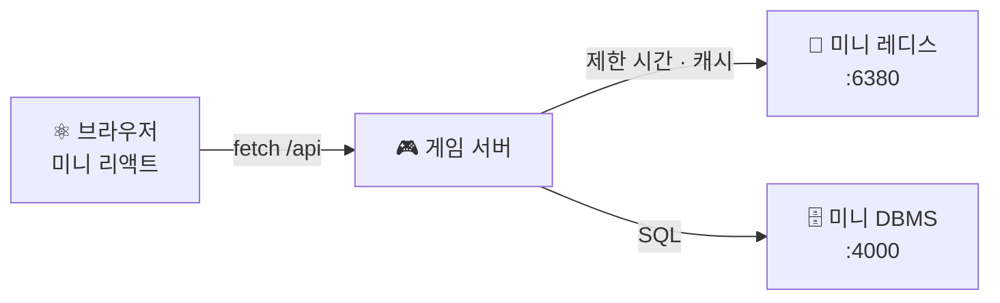
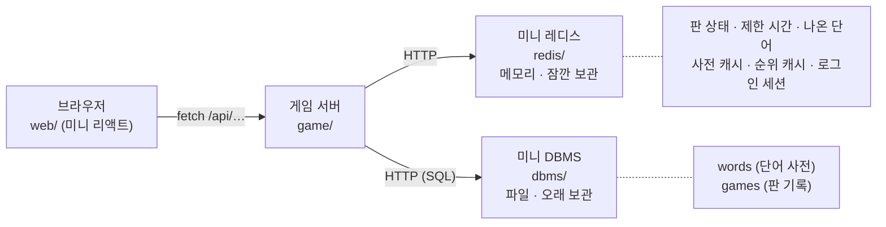
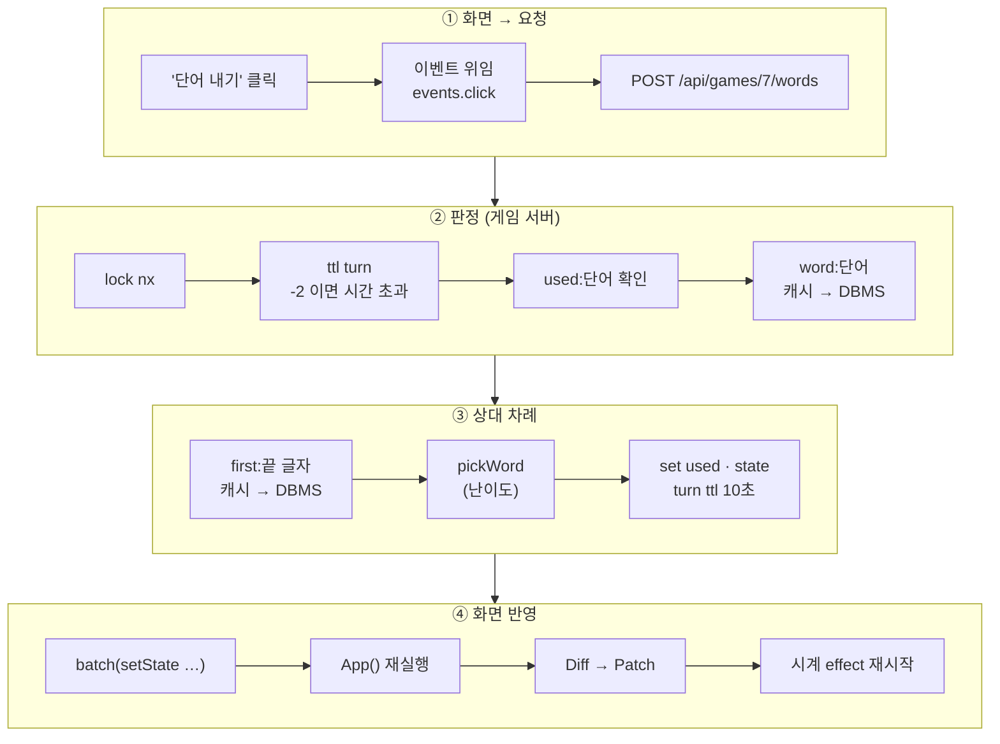

<div align="center">

# 🔤 끝말잇기 (Shiritori)

**직접 만든 Redis · DBMS · React, 세 개를 엮어 돌아가는 끝말잇기 웹 게임**


</div>

<br>

| 🧠 미니 레디스 | 🗄️ 미니 DBMS | ⚛️ 미니 리액트 |
|:---:|:---:|:---:|
| 해시 테이블 · TTL · AOF | SQL 파서 · B+ 트리 · 스레드 풀 | VDOM · Diff · Patch · Hooks |
| **판 진행 · 제한 시간 · 캐시** | **단어 사전 34만 개 · 판 기록** | **게임 화면 전체** |

<br>

<div align="center">

| ⏱️ 제한 시간 | 📖 사전 | ⚡ 캐시 효과 | ✅ 테스트 |
|:---:|:---:|:---:|:---:|
| 10초 = 레디스 TTL | 약 340,000 단어 | 단어 확인 **3.5배** 빠름 | 85 + 67 + 86 = **238개** |

</div>



## 📑 목차

| | | |
|---|---|---|
| [0. 실행](#0-실행-시-주의사항) | [4. 미니 DBMS](#4-미니-dbms-가-하는-일) | [8. 성능 비교](#8-성능-비교-실측) |
| [1. 주요 기능](#1-주요-기능-5줄-요약) | [5. 판의 규칙](#5-판의-규칙-gamerulesjs-gameservicejs) | [9. 테스트](#9-테스트) |
| [2. 전체 구조](#2-전체-구조) | [6. 단어를 냈을 때의 흐름](#6-단어-하나를-냈을-때의-흐름) | [10. 설계 이유](#10-어떻게-이-방식이-나오게-되었는가) |
| [3. 미니 레디스](#3-미니-레디스가-하는-일) | [7. 화면 · 훅](#7-화면-webappjs) | [11. 한계](#11-한계) |

---

## 0. 실행 시 주의사항

Node.js 만 있으면 됩니다. 설치할 패키지가 없습니다. 반드시 **이 디렉토리(`word-chain/`) 안에서** 실행해야 합니다.

```bash
npm start
```

그리고 다음 링크로 들어가서 시연을 해주세요.

```
http://127.0.0.1:3000
```

서버 세 개가 한 번에 켜집니다.

| 서버 | 주소 | 하는 일 |
|---|---|---|
| 게임 서버 | `http://127.0.0.1:3000` | 화면 파일을 내려 주고 게임 API 를 제공 |
| 미니 레디스 | `http://127.0.0.1:6380` | 키-값 저장소 (기록 파일 `data/redis.aof`) |
| 미니 DBMS | `http://127.0.0.1:4000` | SQL 실행 (테이블 파일 `data/db/`) |

<details>
<summary><b>포트 · 폴더 바꾸기, 제작자 계정, 명령 모음</b></summary>

- 포트를 바꾸려면 `PORT=3100 REDIS_PORT=6381 DB_PORT=4001 node server.js`
- 시험용 사전으로 켜려면 `node server.js --data <데이터 폴더> --words <단어 파일 폴더>`

**제작자 계정.** 화면에서 단어를 등록·삭제하려면 계정을 한 번 만들어야 합니다. 아이디와 비밀번호를 물어보고 `admin.json` 에 저장합니다 (비밀번호는 해시로 저장, 저장소에는 올라가지 않음). 게임 자체는 로그인 없이 할 수 있습니다.

```bash
npm run admin
```

| 명령 | 하는 일 |
|---|---|
| `npm start` | 단어 파일 → DBMS 로 넣고, 서버 세 개를 켠다 |
| `npm run admin` | 제작자 계정 만들기 |
| `npm run words` | 단어 파일의 새 단어만 DBMS 에 넣기 |
| `npm run words:reset` | 단어 테이블을 비우고 단어 파일로 다시 채우기 (서버를 끄고 실행) |
| `npm test` / `npm run test:redis` / `npm run test:dbms` | 테스트 (7장) |
| `npm run bench` | 캐시 유무 성능 비교 (8장) |

</details>

## 1. 주요 기능 (5줄 요약)

- **끝말잇기 한 판**: 판을 열면 2~3글자 시작 단어가 무작위로 나오고, 끝 글자로 단어를 내면 상대가 등록 단어 중 하나로 받아친다. 두음법칙(리→이, 래→내, 녀→여)을 인정한다
- **제한 시간 10초 = 레디스 TTL**: 플레이어 차례마다 `game:<번호>:turn` 키에 10초 만료를 걸고, 단어를 낼 때 키가 사라져 있으면 시간 초과로 목숨 -1
- **사전 확인 캐시 + 무효화**: 단어가 있는지는 DBMS 를 선형 탐색해야 알 수 있어서 결과를 레디스에 60초 캐시하고, 단어를 등록·삭제하면 그 단어와 첫 글자의 캐시를 바로 지운다
- **목숨 · 등급 · 점수**: 나와 상대가 목숨 3개씩으로 겨루고, 낸 단어는 "다음에 이을 수 있는 단어 수"로 5등급을 매겨 등급 점수 + 글자 수 점수를 받는다. 판 기록은 DBMS 에 저장되고 점수순으로 순위를 매긴다
- **방금 일어난 일(trace)**: 요청마다 값을 어디서 가져왔는지(레디스 캐시 / DBMS 전체 탐색 / DBMS B+ 트리 인덱스)와 걸린 시간을 화면 오른쪽에 보여 준다

## 2. 전체 구조



게임 서버는 두 저장소를 HTTP API 로만 씁니다. 다른 프로그램이 쓰는 방식 그대로입니다.

| 폴더 | 내용 |
|---|---|
| `redis/` | 미니 레디스. 해시 테이블, 만료, 무효화, 파일 기록(AOF), HTTP API, 클라이언트 ([redis/README.md](redis/README.md)) |
| `dbms/` | 미니 DBMS. SQL 처리기, B+ 트리 인덱스, 스레드 풀 API 서버 ([dbms/README.md](dbms/README.md)) |
| `mini-react/` | 미니 리액트 (Virtual DOM · Diff · Patch · Hooks · 이벤트 위임). 게임 서버가 `/mini-react/…` 주소로 내려 준다 |
| `game/` | 끝말잇기 규칙(`rules.js`), 판 진행(`service.js`), HTTP 서버(`server.js`), 로그인(`auth.js`), 단어 파일 넣기(`import-words.js`) |
| `web/` | 화면. `app.js` 가 미니 리액트의 `h`, `useState`, `useEffect`, `useMemo`, `batch` 를 쓴다 |
| `words/` | 단어 파일과 단어 분석 스크립트 |
| `bench/` | 캐시 성능 비교 |

<details>
<summary><b>2-1. 게임 API (<code>game/server.js</code>)</b></summary>


| 메서드 · 주소 | 하는 일 | 로그인 |
|---|---|---|
| `POST /api/games` | 판 시작 `{ player, level }` | |
| `GET /api/games/:id` | 판 상태 (시간 초과면 여기서 목숨 -1 반영) | |
| `POST /api/games/:id/words` | 단어 내기 `{ word }` | |
| `POST /api/games/:id/giveup` | 포기 | |
| `GET /api/words?first=기차` | 그 글자들로 시작하는 등록 단어 | |
| `POST /api/words` / `DELETE /api/words` | 단어 등록 / 삭제 | 필요 (없으면 401) |
| `POST /api/login` · `POST /api/logout` · `GET /api/session` | 제작자 로그인 · 로그아웃 · 상태 | |
| `GET /api/ranking` | 점수가 높은 판 10개 | |
| `GET /api/records/:id` | 기록 번호로 판 기록 조회 | |
| `GET /api/status` | 두 저장소 상태 | |

응답은 모두 JSON 이고, 오류는 `{ error }` 와 4xx/5xx 상태 코드로 돌려줍니다.


</details>

<details>
<summary><b>2-2. 단어 사전</b></summary>


한 줄에 하나씩 적혀 있고, 서버를 켤 때 새 단어가 사전에 들어갑니다.

| 파일 | 내용 |
|---|---|
| `words/words.txt` | 일반 단어 약 34만 개. 합쳐 둔 사전 JSON 에서 골라 만든 341,033개 (일반 명사 260,129 + 지명 40,692 + 널리 알려진 이름 40,075 + 직접 고른 단어 137) 에 화면에서 등록한 단어가 이어 붙는다 |
| `words/extra.txt` | 직접 고른 단어 (유명인, 회사·브랜드, 게임 회사 이름). `words.txt` 를 다시 만들 때 함께 들어간다 |
| `words/finishers.txt` | 끝내기 단어 (상대가 판을 끝내려고 내는 단어). 한방 단어 1,043개 |
| `words/remove.txt` | 삭제 목록. 화면에서 삭제한 단어가 적히고, 여기 있는 단어는 사전에 들어가지 않는다 |

- 사전 JSON 에서 `words.txt` 를 다시 만들려면 `node words/from-dictionary.js <사전.json> --mecab <mecab-ko-dic 폴더>` 를 실행합니다. 고르는 기준은 그 파일 머리말에 있습니다. 사람 이름은 유명인과 일반인을 구분할 정보가 없어 사전에서 가져오지 않고 `extra.txt` 에 적습니다.
- 한방 · 공격 · 방어 단어 분석은 `node words/analyze.js` 로 하고, 결과는 `words/report/` 에 만들어집니다.


</details>

## 3. 미니 레디스가 하는 일

끝말잇기의 규칙이 그대로 미니 레디스의 기능입니다.

| 키 | 값 | 만료 | 쓰이는 기능 |
|---|---|---|---|
| `game:<번호>` | 진행 중인 판의 상태 (목숨, 점수, 낸 단어) | 30분 (끝난 판은 10분) | 저장 · 조회 |
| `game:<번호>:turn` | 플레이어 차례 표시 | **10초** | 만료. 사라져 있으면 시간 초과 → 목숨 -1 |
| `game:<번호>:used:<단어>` | 이번 판에 나온 단어 | 30분 | 조회 (있으면 "이미 나온 단어") |
| `game:<번호>:lock` | 처리 중 표시 | 5초 | `nx` (없을 때만 저장) |
| `word:<단어>` | 사전에 있는지 `{ known, finisher }` | 60초 | 캐시 |
| `first:<글자>` | 그 글자로 시작하는 단어 목록 | 60초 | 캐시 |
| `ranking` | 점수가 높은 판 10개 | 5초 | 캐시 |
| `game:seq`, `stats:games` | 판 번호, 끝난 판 수 | 없음 | `incr` |
| `session:<토큰>` | 제작자 로그인 상태 | **30분** | 만료 → 자동 로그아웃 |
| `login:fail:<접속 주소>` | 로그인 실패 횟수 | 1분 | `incr` + 만료. 5번 틀리면 1분 동안 로그인 거절 |

<details>
<summary><b>3-1. 해시 테이블 (<code>redis/src/hash-table.js</code>)</b></summary>


키를 FNV-1a 해시 함수로 숫자로 바꾸고, 그 숫자로 칸(버킷) 번호를 정합니다. 같은 칸에 여러 키가 오면 연결 리스트로 잇습니다(체이닝).
칸 수는 2의 거듭제곱이고, 저장된 키가 칸 수의 75%를 넘으면 2배로 늘립니다.


</details>

<details>
<summary><b>3-2. 만료된 값 처리 — 제한 시간</b></summary>


```
플레이어 차례 시작:  set game:7:turn 1  (ttl 10초)
단어를 냈을 때:      ttl game:7:turn  →  -2 (없는 키) 이면 시간 초과 → 목숨 하나를 잃는다
```

만료된 키는 두 가지 방법으로 지워집니다.

- **지연 삭제**: 키를 조회하는 순간 만료 시각이 지났으면 지우고 "없음"으로 답합니다.
- **주기 삭제**: 0.1초마다 만료가 걸린 키 일부를 뽑아 지난 것을 지웁니다. 아무도 조회하지 않는 키가 메모리에 남지 않습니다.

화면의 시계는 보여 주기용이고, 판정은 서버의 키 만료로 합니다. 화면 시계가 0이 되면 `GET /api/games/:id` 로 물어보고, 서버는 키가 사라져 있으면 그때 목숨을 뺍니다.


</details>

<details>
<summary><b>3-3. 캐시와 무효화 (<code>redis/src/cache.js</code>, <code>game/service.js</code>)</b></summary>


```
단어 확인:  word:기차 가 레디스에 있나?
              있다 → 그대로 사용                         (레디스 캐시)
              없다 → DBMS 에서 SELECT … WHERE word = '기차'  (전체 탐색) → 결과를 60초 동안 레디스에 저장
```

"없는 단어"라는 결과도 캐시합니다. 그래서 무효화가 없으면 방금 등록한 단어가 60초 동안 "없는 단어"로 판정됩니다.

| 무효화하는 때 | 지우는 키 | 방법 |
|---|---|---|
| 단어 등록 · 삭제 | `word:<단어>`, `first:<첫 글자>` | 키 하나씩 `del` |
| 판 종료 | `game:<번호>:used:` 로 시작하는 키 전부 | prefix 로 묶어서 `delByPrefix` |
| 판 종료 | `ranking` | `del` |
| 서버를 켤 때 | `word:`, `first:` 로 시작하는 키 전부 | `delByPrefix` (단어 파일이 바뀌었을 수 있음) |
| 그 밖에 | 모든 캐시 | 만료 시간이 지나면 저절로 |


</details>

<details>
<summary><b>3-4. 제작자 로그인 (<code>game/auth.js</code>)</b></summary>


```
로그인:     아이디·비밀번호 확인 → 무작위 토큰 생성 → set session:<토큰> { id }  (ttl 30분)
단어 등록:  요청에 Authorization: Bearer <토큰> → get session:<토큰> 이 없으면 401
로그아웃:   del session:<토큰>
```

- 비밀번호는 저장하지 않습니다. `scrypt(비밀번호, salt)` 로 만든 해시만 `admin.json` 에 둡니다.
- 30분이 지나면 세션 키가 만료돼 저절로 로그아웃됩니다. 따로 지우는 코드가 없습니다.
- 로그인을 틀릴 때마다 `login:fail:<접속 주소>` 를 `incr` 하고 1분 만료를 겁니다. 5번이 되면 1분 동안 맞는 비밀번호도 받지 않습니다(429).
- 화면은 토큰을 `sessionStorage` 에 두고, 새로 고침하면 `/api/session` 으로 아직 살아 있는 로그인인지 물어봅니다.
- 검사는 서버에서 합니다. 화면에서 등록 폼을 숨기는 것은 편의일 뿐이고, 토큰 없이 API 를 직접 호출해도 401 로 거절됩니다.


</details>

<details>
<summary><b>3-5. 동시성</b></summary>


미니 레디스는 명령을 한 번에 하나씩 실행합니다. 요청 본문을 다 읽은 뒤 저장소 함수를 동기 호출 한 번으로 실행하기 때문에, 요청이 겹쳐 들어와도 명령 사이에 다른 명령이 끼어들지 않습니다.

- **판 번호**: `incr game:seq`. 12판을 동시에 시작해도 번호가 겹치지 않습니다.
- **같은 판에 동시에 낸 단어**: `set game:7:lock 1 nx` 에 성공한 요청 하나만 판을 다룹니다. 8개를 동시에 보내도 1개만 처리되고 나머지는 409 입니다.
- **단어 등록 · 삭제**: 게임 서버 안에서 Promise 한 줄로 세워 처리합니다. "있는지 확인 → INSERT" 사이에 다른 등록이 끼어들지 않아, 같은 단어를 동시에 20번 등록해도 1건만 들어갑니다.


</details>

<details>
<summary><b>3-6. 서버가 꺼졌을 때 (<code>redis/src/aof.js</code>)</b></summary>


쓰기 명령을 `data/redis.aof` 에 한 줄씩 이어 적고, 서버를 켤 때 처음부터 다시 실행해 복구합니다. 만료 시각을 "남은 시간"이 아닌 "끝나는 시각"으로 적어 두어, 꺼져 있던 동안 지난 시간도 반영됩니다.


</details>

## 4. 미니 DBMS 가 하는 일

테이블 구조 (`game/schema.json`)

| 테이블 | 열 |
|---|---|
| `words` | `id`, `word`, `first`(첫 글자), `last`(끝 글자), `finisher`(끝내기 여부), `removed`(지운 기록 여부) |
| `games` | `id`, `player`, `level`, `turns`, `result`, `reason`, `score` |

| 게임 동작 | SQL | 읽는 방법 |
|---|---|---|
| 단어 파일 넣기 | `INSERT INTO words …` 를 SQL 파일로 만들어 `dbms/cli.js` 로 실행 (500개씩 묶음) | Phase 1 (CLI) |
| 사전 확인 | `SELECT id, finisher, removed FROM words WHERE word = '기차'` | 전체 탐색 |
| 상대의 후보 찾기 | `SELECT id, word, finisher, removed FROM words WHERE first = '차'` | 전체 탐색 |
| 시작 단어 뽑기 | 단어 번호를 무작위로 골라 `SELECT word FROM words WHERE id = 163947` | B+ 트리 인덱스 |
| 단어 삭제 | `INSERT INTO words (…, removed) VALUES (…, 1)` | 아래 설명 |
| 판 기록 저장 | `INSERT INTO games …` → 기록 번호 자동 부여 | B+ 트리에 등록 |
| 기록 번호로 조회 | `SELECT * FROM games WHERE id = 7` | B+ 트리 인덱스 |
| 순위 | `SELECT … FROM games ORDER BY score DESC LIMIT 10` | 전체 탐색 |

요청은 워커 스레드 4개가 나눠 처리합니다. 전체 탐색이 느리기 때문에 미니 레디스가 앞에서 캐시합니다.

## 5. 판의 규칙 (`game/rules.js`, `game/service.js`)

**시작 단어.** 판을 열 때 서버가 단어 번호를 무작위로 뽑아 그 단어를 찾습니다. 2~3글자가 아니거나, 지운 단어거나, 이을 단어가 없으면 다시 뽑습니다 (최대 30번). 사전이 비어 있으면 시작 단어 없이 플레이어가 아무 단어로 시작합니다.
단어 번호로 찾기 때문에 B+ 트리 인덱스를 타고, 사전이 34만 개여도 바로 찾습니다. 글자 수 제한은 시작 단어에만 있고, 내는 단어에는 없습니다 (한글 2글자 이상).

**단어 판정 순서.** 형식(한글 2글자 이상) → 시작 글자 → 이번 판에 이미 나옴 → 사전에 없음. 앞의 조건을 통과한 단어만 사전을 찾아봅니다. 틀린 단어는 목숨을 빼지 않고 이유만 알려 주며, 시간은 계속 흐릅니다.

**상대가 단어를 고르는 방법.**

1. 내가 낸 단어의 끝 글자(와 두음법칙으로 바뀐 글자)로 시작하는 등록 단어를 모읍니다.
2. 이번 판에 이미 나온 단어를 뺍니다.
3. 남은 것 중 하나를 무작위로 냅니다. 남은 것이 없으면 상대가 목숨을 잃습니다.

끝내기 단어만 난이도에 따라 다르게 다룹니다.

| 난이도 | 서버 이름 | 후보에 끝내기 단어가 있을 때 |
|---|---|---|
| 아주 쉬움 | `easy` | 쓰지 않음 |
| 쉬움 | `mild` | 25% 확률로 냄 |
| 보통 | `normal` | 50% 확률로 냄 |
| 어려움 | `tough` | 75% 확률로 냄 |
| 절대적 | `hard` | 항상 냄 |

**단어 등급.** 낸 단어마다 "그 단어 다음에 이을 수 있는 단어가 사전에 몇 개 있는가"로 등급을 매겨, 화면 아래 "낸 단어" 목록에 순서대로 보여 줍니다. 이번 판에 이미 나온 단어도 포함한 개수라서, 같은 단어는 언제 내도 같은 등급입니다.

| 등급 | 이을 수 있는 단어 | 표시 | 등급 점수 |
|---|---|---|---:|
| 한방 | 0개 | 💀 붉은색 | 2,000 |
| 공격 | 1~10개 | 🔥 주황색 | 1,000 |
| 까다로움 | 11~100개 | ⚡ 황토색 | 500 |
| 보통 | 101~1,000개 | 🙂 남색 | 250 |
| 넉넉 | 1,001개 이상 | 🌱 청록색 | 100 |

**점수 = 등급 점수 + 글자 수 점수.** 긴 단어는 드물어서 크게 줍니다. 10글자 300점이 기준이고, 9글자까지는 그 비율의 제곱, 10글자부터는 한 글자마다 60점씩 더합니다. 시작 단어는 0점입니다.

| 글자 수 | 2 | 3 | 5 | 9 | 10 | 11 | 12 |
|---|---:|---:|---:|---:|---:|---:|---:|
| 글자 수 점수 | 12 | 27 | 75 | 243 | 300 | 360 | 420 |

나와 상대의 점수가 따로 쌓이고, 판이 끝나면 내 점수가 판 기록에 저장돼 순위의 기준이 됩니다.

**목숨.** 나와 상대가 목숨을 3개씩 갖습니다. 이을 단어를 내지 못한 쪽이 하나를 잃고, 아직 나오지 않은 새 시작 단어로 이어 갑니다. 한쪽의 목숨이 0 이 되면 판이 끝납니다.

| 상황 | 결과 |
|---|---|
| 제한 시간 안에 내지 못함 | 내 목숨 -1 (그때 낸 단어는 받지 않음) |
| 상대가 낸 단어 다음에 이을 등록 단어가 없음 | 내 목숨 -1 |
| 내가 낸 단어 다음에 상대가 이을 단어가 없음 | 상대 목숨 -1 |
| 틀린 단어를 냄 (없는 단어, 이미 나온 단어) | 목숨은 그대로, 시간만 흐름 |
| 포기 | 남은 목숨과 상관없이 판 종료 |

목숨을 잃어도 이미 나온 단어는 다시 낼 수 없습니다. 목숨과 점수는 판의 상태와 함께 미니 레디스의 `game:<번호>` 키에 들어 있습니다.

## 6. 단어 하나를 냈을 때의 흐름



<details>
<summary><b>요청 + 판정</b></summary>


1. **클릭 감지**: 미니 리액트가 루트에 하나만 달아 둔 click 리스너가 이벤트를 받고, 최신 VDOM 에서 `단어 내기` 버튼의 `events.click` 을 찾아 실행합니다. 입력 칸은 state 로 관리하지 않고, 이때 DOM 에서 값을 읽습니다. (Enter 키는 미니 리액트가 click 만 위임하므로 `useEffect` 에서 따로 연결합니다)
2. **요청**: `api.playWord(7, '기차')` → `POST /api/games/7/words`
3. **잠금**: `set game:7:lock 1 nx ttl 5초`. 이미 처리 중인 요청이 있으면 409 로 돌려보냅니다.
4. **시간 확인**: `ttl game:7:turn` 이 `-2`(키 없음)면 시간 초과입니다. 목숨을 하나 빼고 새 시작 단어를 놓은 뒤 응답합니다.
5. **단어 판정**: 형식 → 시작 글자 → `get game:7:used:기차` → `word:기차` 캐시(없으면 DBMS 전체 탐색 후 60초 저장) 순서로 봅니다. 하나라도 걸리면 이유와 함께 응답하고 판은 그대로 둡니다.


</details>

<details>
<summary><b>상대 차례 + 저장</b></summary>


6. **받아들임**: `set game:7:used:기차`, `first:차` / `first:자`(두음법칙) 목록으로 이을 수 있는 단어 수를 세어 등급과 점수를 매깁니다.
7. **상대 선택**: 그 목록에서 이번 판에 나온 단어를 빼고 `pickWord` 로 하나 고릅니다. 없으면 상대 목숨 -1.
8. **내 다음 차례 확인**: 상대 단어 다음에 내가 이을 단어가 하나도 없으면 내 목숨 -1.
9. **저장**: `set game:7`(판 상태, 30분), `set game:7:turn`(10초)로 새 차례를 열고, 잠금 키를 지웁니다.
10. **응답**: `{ accepted, computer, game, trace }`. `trace` 에는 단계마다 캐시였는지 DBMS 였는지와 걸린 시간이 들어 있습니다.


</details>

<details>
<summary><b>화면 반영</b></summary>


11. **배칭**: `setGame`, `setDeadline`, `setNow`, `setTrace`, `setNotice` 를 `batch` 로 묶어 리렌더는 한 번만 합니다.
12. **리렌더 + Diff**: `App()` 이 다시 실행되고, `useMemo` 는 deps `[history]` 가 바뀌었으므로 큰 박스와 단어 줄 모양을 다시 만듭니다. Diff 결과대로 바뀐 부분만 Patch 합니다.
13. **effect**: 시계 `useEffect` 의 deps `[gameId, playing, deadline]` 중 `deadline` 이 바뀌었으므로 이전 타이머를 정리하고 새 0.2초 타이머를 겁니다.


</details>

## 7. 화면 (`web/app.js`)

과제 제약대로 state 와 훅은 루트 컴포넌트 `App` 에만 있고, 나머지 컴포넌트(`Tabs`, `Stage`, `Scoreboard`, `Log`, `Clock`, `Trace` …)는 props 만 받는 순수 함수입니다.

| 훅 | deps | 다시 실행되는 때 | 하는 일 |
|---|---|---|---|
| `useEffect` (Enter 키) | `[]` | 마운트 때 한 번 | 입력 칸에서 Enter 를 누르면 연결된 버튼을 클릭한 것으로 처리 |
| `useEffect` (로그인 복원) | `[]` | 마운트 때 한 번 | `sessionStorage` 의 토큰이 아직 유효한지 서버에 물어봄 |
| `useEffect` (차례 시계) | `[gameId, playing, deadline]` | 판이 바뀌거나, 끝나거나, 새 차례가 열릴 때 | 0.2초마다 `now` 를 바꾸고, 시간이 다 되면 서버에 판 상태를 물어봄 |
| `useEffect` (기록 화면) | `[tab]` | 탭을 바꿀 때 | 기록 탭이면 순위와 저장소 상태를 불러옴 |
| `useMemo` (판 모양) | `[history]` | 단어가 새로 나왔을 때 | 나온 단어를 큰 박스 · 단어 줄 모양으로 변환 |

시계가 가는 동안에는 `now` 만 바뀌고 `history` 는 그대로라서 `useMemo` 가 다시 계산되지 않습니다. Diff 결과도 남은 시간 글자와 막대 너비 두 곳만 고칩니다.

## 8. 성능 비교 (실측)

`npm run bench` 결과입니다. (Windows 11, Node.js 26)

등록 단어 200,000개, 단어 확인 300번 (단어 100개 × 3번)

| | 걸린 시간 | 확인 한 번 평균 | DBMS 를 읽은 횟수 |
|---|---:|---:|---:|
| 미니 레디스 없이 | 16,813 ms | 56.04 ms | 300 |
| 미니 레디스를 캐시로 | 4,801 ms | 16.00 ms | 100 |

- 전체 시간이 약 3.5배 빨라졌습니다. 같은 단어를 여러 번 확인할수록 차이가 커집니다.
- 캐시에 있는 단어를 꺼내는 데는 평균 0.11 ms, DBMS 선형 탐색 한 번은 평균 56.04 ms 입니다.

## 9. 테스트

`node:test` 로 작성했고 테스트 프레임워크는 쓰지 않았습니다.

| 명령 | 대상 | 개수 |
|---|---|---:|
| `npm test` | 끝말잇기 (규칙, 판 진행, 시작 단어, 로그인, HTTP API, 단어 파일 넣기) | 85 |
| `npm run test:redis` | 미니 레디스 | 67 |
| `npm run test:dbms` | 미니 DBMS | 86 |

<details>
<summary><b>테스트 파일별 검증 내용</b></summary>

| 파일 (`game/__tests__/`) | 검증하는 것 |
|---|---|
| `rules.test.js` | 단어 형식, 두음법칙, 판정 순서, 난이도별 선택 확률, 등급, 글자 수 점수 |
| `service.test.js` | 등록 · 삭제 · 무효화, 판 진행, 만료, 캐시, 목숨 · 점수, 순위, 동시성 |
| `start-word.test.js` | 시작 단어 (2~3글자, 이을 단어 있음, 빈 사전, 30번 실패) |
| `auth.test.js` | 계정 만들기, 로그인 · 로그아웃, 세션 30분, 실패 5번 제한 |
| `server.test.js` | 정적 파일 · 폴더 밖 요청 차단, API 전체 흐름, 4xx 응답, 로그인 필요 API |
| `import-words.test.js` | 단어 파일 읽기, SQL 만들기, 중복 없이 가져오기, reset, 삭제 목록 |

판 진행 테스트는 미니 레디스 서버와 미니 DBMS 서버를 실제로 띄워서 합니다.

| 확인한 것 | 예 |
|---|---|
| 규칙 | 두음법칙 17가지, 거절 이유 4가지, 난이도별 선택 (1만 번 뽑아 확률 확인) |
| 만료 | 제한 시간이 지나면 목숨 -1, 시간 안에 내면 다시 채워짐 |
| 목숨 · 점수 | 3번 잃으면 판 종료, 같은 시간 초과로 두 번 잃지 않음, 등급 · 글자 수 점수와 판 기록 저장 |
| 캐시 | 처음은 DBMS 전체 탐색, 두 번째는 레디스 |
| 무효화 | "없는 단어"로 캐시된 결과가 등록 직후 사라짐, 삭제한 단어를 상대가 바로 내지 않음 |
| 동시성 | 같은 단어 동시 등록 20번 → 1건, 같은 판에 동시 제출 8번 → 1번만 처리, 12판 동시 진행 |
| 엣지 케이스 | 빈 사전, 깨진 JSON, 작은따옴표가 든 이름, 폴더 밖 파일 요청, 끝난 판에 단어 내기 |

</details>

## 10. 어떻게 이 방식이 나오게 되었는가

**제한 시간을 왜 TTL 로 판정하는가.** 처음엔 화면의 시계가 0 이 되면 "시간 초과"를 서버에 알리는 방식을 생각할 수 있습니다. 하지만 그러면 화면을 조작하거나 요청을 늦게 보내는 것만으로 시간을 늘릴 수 있습니다. 그래서 차례가 열릴 때 서버가 `turn` 키에 10초 만료를 걸고, 판정은 오직 "그 키가 아직 있는가"로 합니다. 화면 시계는 남은 시간을 보여 주기만 합니다.

**왜 사전 확인을 캐시하는가.** 미니 DBMS 는 `word` 열에 인덱스가 없어 단어 하나를 확인할 때마다 34만 줄을 훑습니다. 끝말잇기는 같은 단어(특히 `first:<글자>` 후보 목록)를 반복해서 찾기 때문에, 결과를 레디스에 잠깐 두면 DBMS 를 읽는 횟수가 크게 줄어듭니다 (8장).

**DELETE 없이 삭제하기.** 미니 DBMS 는 과제 범위대로 `INSERT` 와 `SELECT` 만 지원합니다. 그래서 단어를 지울 때 줄을 없애지 않고, 같은 단어를 `removed = 1` 로 한 줄 더 넣습니다. 같은 단어가 여러 줄이면 번호가 가장 큰 줄을 따르므로, 그 단어는 없는 단어가 됩니다. 다시 등록하면 `removed = 0` 인 줄이 또 하나 붙어 되살아납니다. (파일 끝에 이어 쓰기만 하는 방식)

**왜 "단어 찾기"를 첫 글자로 하는가.** 미니 DBMS 에는 `LIKE` 가 없습니다. 그래서 `first = '기'` 로 첫 글자가 같은 단어를 가져온 뒤(캐시됨) 게임 서버에서 앞부분을 비교해 거릅니다.

## 11. 한계

- 단어를 삭제해도 테이블 파일에서 줄이 사라지지는 않습니다. "지웠다"는 줄이 하나 더 붙습니다. 파일을 줄이려면 서버를 끄고 `npm run words:reset` 으로 단어 파일에서 다시 만듭니다.
- 끝내기 단어는 화면에서 지정할 수 없고 `words/finishers.txt` 에 적습니다. 끝내기 단어를 일반 단어로 되돌리려면 그 파일에서 지우고 `npm run words:reset` 을 실행합니다.
- 상대는 등록된 단어만 압니다. 사전이 작으면 금방 집니다.
- 단어의 뜻이나 품사는 확인하지 않습니다. 등록한 단어가 곧 규칙입니다.
