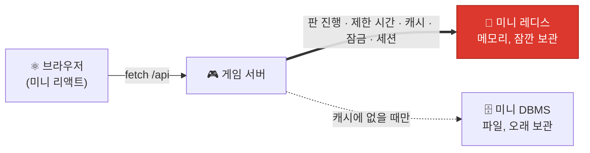
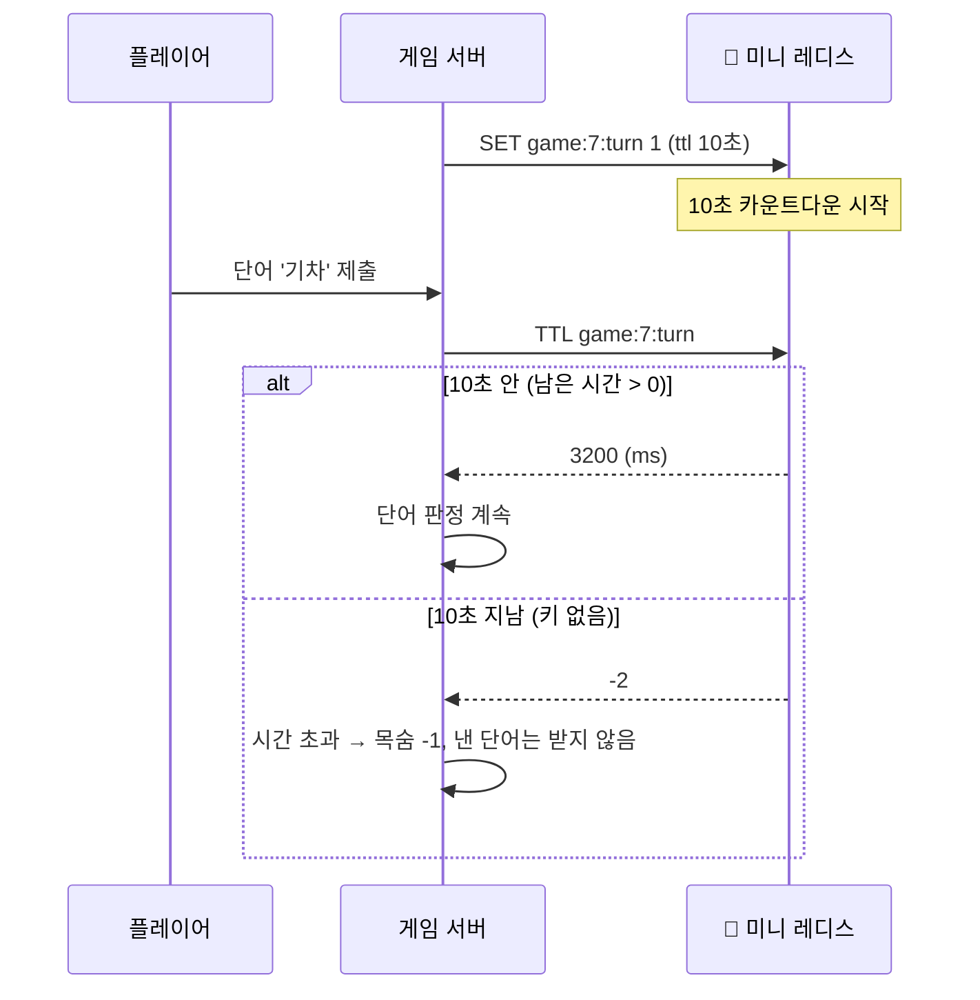
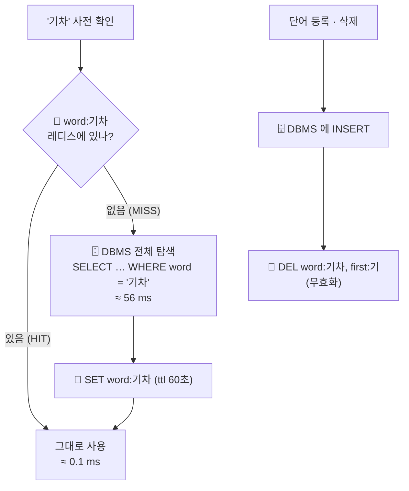
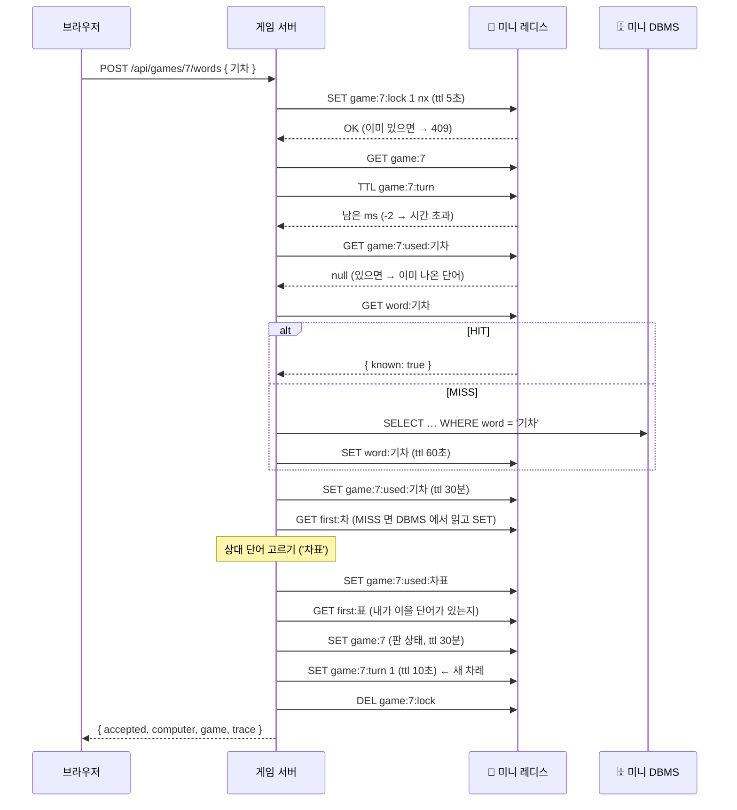

<div align="center">

# 🧠 끝말잇기로 보는 미니 레디스

**끝말잇기의 규칙 하나하나를, 직접 만든 Redis 의 기능으로 돌립니다**


</div>

<br>

## 🎯 레디스 기능 = 게임 규칙

| 미니 레디스 기능 | 끝말잇기에서 하는 일 | 키 |
|---|---|---|
| ⏱️ **TTL (만료)** | 한 차례 **10초 제한 시간**. 키가 사라지면 시간 초과 → 목숨 -1 | `game:<번호>:turn` |
| ⚡ **캐시 (Cache-Aside)** | 34만 단어 사전 확인을 DBMS 대신 레디스에서 → **3.5배 빠름** | `word:<단어>`, `first:<글자>` |
| 🧹 **무효화** | 단어를 등록·삭제하면 그 캐시를 바로 지워 **다음 차례부터 반영** | `del`, `delByPrefix` |
| 🔒 **nx (없을 때만 저장)** | 같은 판에 동시에 낸 단어는 **하나만 처리** (잠금) | `game:<번호>:lock` |
| ➕ **incr** | 판 번호를 겹치지 않게 발급, 로그인 실패 횟수 세기 | `game:seq`, `login:fail:*` |
| 🔑 **세션 TTL** | 제작자 로그인 **30분 뒤 자동 로그아웃** | `session:<토큰>` |
| 💾 **AOF (영속성)** | 서버가 꺼졌다 켜져도 **진행 중인 판이 그대로** | `data/redis.aof` |

<br>

<div align="center">

| ⏱️ 제한 시간 | ⚡ 단어 확인 | 🔒 동시 제출 8번 | 💾 강제 종료 후 |
|:---:|:---:|:---:|:---:|
| 서버의 키 만료로 판정 | 56 ms → **16 ms** | → **1번만 처리** | **판 그대로 복구** |

</div>



게임 서버는 미니 레디스를 **HTTP API 로만** 씁니다. 다른 프로그램이 레디스를 쓰는 방식 그대로입니다.
미니 DBMS 는 단어 사전과 판 기록의 원본이고, 미니 리액트는 화면입니다 (부록).

## 📑 목차

| | |
|---|---|
| [0. 실행](#0-실행) | [5. 단어 하나를 냈을 때의 레디스 명령](#5-단어-하나를-냈을-때의-레디스-명령) |
| [1. 레디스 키 지도](#1-레디스-키-지도) | [6. 동시성 — 잠금과 incr](#6-동시성--잠금과-incr) |
| [2. 해시 테이블](#2-해시-테이블--모든-키가-들어가는-곳) | [7. 세션 — 로그인도 TTL](#7-세션--로그인도-ttl) |
| [3. TTL — 10초 제한 시간](#3-ttl--10초-제한-시간) | [8. AOF — 서버가 꺼져도](#8-aof--서버가-꺼져도) |
| [4. 캐시와 무효화](#4-캐시와-무효화--사전-확인) | [9. 성능](#9-성능-실측) · [10. 테스트](#10-테스트) · [11. 한계](#11-실제-redis-와의-차이와-한계) · [부록](#부록) |

---

## 0. 실행

Node.js 만 있으면 됩니다. 설치할 패키지가 없습니다. 반드시 **이 디렉토리(`word-chain/`) 안에서** 실행해야 합니다.

```bash
npm start
```

그리고 다음 링크로 들어가서 시연을 해주세요.

```
http://127.0.0.1:3000
```

| 서버 | 주소 | 하는 일 |
|---|---|---|
| 게임 서버 | `http://127.0.0.1:3000` | 화면 파일과 게임 API |
| **미니 레디스** | `http://127.0.0.1:6380` | 키-값 저장소 (기록 파일 `data/redis.aof`) |
| 미니 DBMS | `http://127.0.0.1:4000` | SQL 실행 (테이블 파일 `data/db/`) |

> 💡 **시연 포인트**: 화면 오른쪽 **"방금 일어난 일"** 패널에 요청마다 값을 어디서 가져왔는지(🧠 레디스 캐시 / 🗄️ DBMS 전체 탐색 / 🗄️ DBMS 인덱스)와 걸린 시간이 나옵니다. 같은 글자로 두 번 이어 보면 두 번째는 레디스에서 나오는 것을 볼 수 있습니다.

<details>
<summary><b>명령 모음 · 제작자 계정 · 포트 바꾸기</b></summary>

| 명령 | 하는 일 |
|---|---|
| `npm start` | 단어 파일 → DBMS 로 넣고, 서버 세 개를 켠다 |
| `npm run admin` | 제작자 계정 만들기 (화면에서 단어를 등록·삭제할 때 필요) |
| `npm run words` / `npm run words:reset` | 단어 파일의 새 단어만 넣기 / 테이블을 비우고 다시 채우기 (서버를 끄고 실행) |
| `npm test` / `npm run test:redis` / `npm run test:dbms` | 테스트 (10장) |
| `npm run bench` | 캐시 유무 성능 비교 (9장) |

- 제작자 계정은 아이디와 비밀번호를 물어보고 `admin.json` 에 저장합니다 (비밀번호는 해시로 저장, 저장소에는 올라가지 않음). 게임은 로그인 없이 합니다.
- 포트 바꾸기: `PORT=3100 REDIS_PORT=6381 DB_PORT=4001 node server.js`
- 시험용 사전으로 켜기: `node server.js --data <데이터 폴더> --words <단어 파일 폴더>`

</details>

## 1. 레디스 키 지도

한 판이 돌아가는 동안 미니 레디스에 들어가는 키 전부입니다. 키 이름을 `종류:번호:…` 로 지어 두어서, 접두사로 묶어 한꺼번에 지울 수 있습니다.

| 키 | 값 | 만료 | 쓰이는 기능 |
|---|---|---|---|
| `game:<번호>` | 진행 중인 판의 상태 (목숨, 점수, 낸 단어) | 30분 (끝난 판은 10분) | 저장 · 조회 |
| `game:<번호>:turn` | 플레이어 차례 표시 | **10초** | 만료. 사라져 있으면 시간 초과 |
| `game:<번호>:used:<단어>` | 이번 판에 나온 단어 | 30분 | 조회 (있으면 "이미 나온 단어") |
| `game:<번호>:lock` | 처리 중 표시 | 5초 | `nx` (없을 때만 저장) |
| `word:<단어>` | 사전에 있는지 `{ known, finisher }` | 60초 | 캐시 |
| `first:<글자>` | 그 글자로 시작하는 단어 목록 | 60초 | 캐시 |
| `ranking` | 점수가 높은 판 10개 | 5초 | 캐시 |
| `game:seq`, `stats:games` | 판 번호, 끝난 판 수 | 없음 | `incr` |
| `session:<토큰>` | 제작자 로그인 상태 | **30분** | 만료 → 자동 로그아웃 |
| `login:fail:<접속 주소>` | 로그인 실패 횟수 | 1분 | `incr` + 만료 |

## 2. 해시 테이블 — 모든 키가 들어가는 곳

`Map` / `Object` 를 쓰지 않고 **버킷 배열 + 연결 리스트**로 직접 만들었습니다 (`redis/src/hash-table.js`).

```
buckets (capacity = 16)
 [0] null
 [1] → { key: 'game:7:turn', … } → { key: 'word:기차', … } → null     ← 충돌: 연결 리스트로 잇는다
 [2] null
 [3] → { key: 'game:7', … } → null
 …
```

1. **해시 계산**: 키를 FNV-1a 로 32비트 정수로 바꾼다. 같은 문자열은 항상 같은 숫자
2. **버킷 번호**: `해시 & (capacity - 1)`. capacity 가 2의 거듭제곱이라 나머지 연산과 같다
3. **충돌**: 같은 버킷의 노드를 `next` 로 잇고(분리 연결법), 찾을 때는 키를 직접 비교
4. **리사이즈**: 노드 수가 `capacity × 0.75` 를 넘으면 2배로 늘려 모든 노드를 다시 배치 → 연결 리스트가 짧게 유지돼 평균 O(1)

저장소(`store.js`)는 해시 테이블을 **두 개** 씁니다. `data`(키 → 값)와 `expires`(키 → 만료 시각). 실제 Redis 와 같은 구성입니다.
100만 개를 넣었을 때 가장 긴 연결 리스트는 6개였습니다. 자세한 설계는 [redis/README.md](redis/README.md) 에 있습니다.

## 3. TTL — 10초 제한 시간

**제한 시간은 화면의 시계가 아니라 레디스의 키 만료로 판정합니다.**



만료된 키는 두 가지 방법으로 지워집니다.

| 방식 | 언제 | 하는 일 |
|---|---|---|
| **지연 삭제** | 키에 접근할 때마다 (`get`, `ttl`, `incr` …) | 만료 시각이 지났으면 그 자리에서 지우고 "없음"으로 답한다 |
| **주기 삭제** | 0.1초마다 | `expires` 테이블을 20개쯤 훑어 만료된 키를 지운다. 1/4 넘게 만료돼 있었으면 한 번 더 |

- 지연 삭제만 있으면 아무도 다시 찾지 않는 키(끝난 판의 `turn` 등)가 메모리에 남고, 주기 삭제만 있으면 청소 전까지 만료된 값이 보입니다. 둘을 같이 써서 **만료된 값은 절대 돌려주지 않으면서** 메모리도 회수합니다.
- 화면의 시계는 보여 주기용입니다. 0 이 되면 `GET /api/games/:id` 로 물어보고, 서버는 `turn` 키가 사라져 있으면 그때 목숨을 뺍니다. 화면을 조작해도 시간을 늘릴 수 없습니다.

## 4. 캐시와 무효화 — 사전 확인

미니 DBMS 는 `word` 열에 인덱스가 없어서, 단어 하나를 확인할 때마다 **34만 줄을 처음부터** 훑어야 합니다. 그래서 결과를 미니 레디스에 60초 동안 둡니다 (`redis/src/cache.js` 의 `getOrLoad`).



**무효화가 없으면 생기는 문제.** "없는 단어"라는 결과도 캐시합니다. 그래서 무효화가 없으면 방금 등록한 단어가 60초 동안 "등록되지 않은 단어"로 거절됩니다. 그래서 원본을 바꿀 때마다 그 키를 바로 지웁니다.

| 무효화하는 때 | 지우는 키 | 방법 |
|---|---|---|
| 단어 등록 · 삭제 | `word:<단어>`, `first:<첫 글자>` | 키 하나씩 `del` |
| 판 종료 | `game:<번호>:used:` 로 시작하는 키 전부 | 접두사로 묶어서 `delByPrefix` |
| 판 종료 | `ranking` | `del` |
| 서버를 켤 때 | `word:`, `first:` 로 시작하는 키 전부 | `delByPrefix` (단어 파일이 바뀌었을 수 있음) |
| 그 밖에 | 모든 캐시 | ttl 이 지나면 저절로. 지우는 것을 잊어도 언젠가 사라진다 |

`cache.js` 가 추가로 처리하는 두 가지

- **동시에 놓친 요청 합치기**: 캐시에 없는 같은 키를 여러 요청이 동시에 찾으면, 먼저 시작한 DBMS 조회 하나를 나머지가 함께 기다립니다. 원본은 1번만 읽습니다.
- **레디스가 죽었을 때**: 캐시 오류는 무시하고 DBMS 에서 읽습니다. 느려질 뿐 게임은 동작합니다.

## 5. 단어 하나를 냈을 때의 레디스 명령

'단어 내기'를 한 번 누르면 게임 서버가 미니 레디스에 보내는 명령 순서입니다 (`game/service.js` 의 `play`).



1. **잠금**: `nx` 로 잠금 키를 만든 요청만 들어갑니다 (6장).
2. **시간 확인**: `turn` 키가 없으면(`-2`) 시간 초과입니다 (3장).
3. **판정**: 형식 → 시작 글자 → `used` 키 → `word:` 캐시 순서. 앞의 조건을 통과한 단어만 사전을 찾아봅니다.
4. **상대 차례**: `first:<끝 글자>` 캐시에서 후보를 꺼내 이번 판에 나온 단어(`used`)를 빼고 하나를 고릅니다. 두음법칙이 있으면 `first:리`, `first:이` 처럼 두 키를 봅니다.
5. **새 차례**: 판 상태를 저장하고 `turn` 키에 다시 10초를 겁니다.
6. **응답의 `trace`**: 위 단계마다 캐시였는지 DBMS 였는지와 걸린 시간을 담아 화면에 보여 줍니다.

판이 끝나면 판 기록을 DBMS 에 `INSERT` 하고, 레디스에서는 `DEL game:7:turn`, `delByPrefix game:7:used:`, `DEL ranking`, `INCR stats:games` 를 실행합니다.

## 6. 동시성 — 잠금과 incr

미니 레디스는 **락 없이** 동시성 문제를 막습니다. 실제 Redis 와 같은 방식입니다.

- 저장소 명령(`store.js`)은 전부 중간에 `await` 가 없는 **동기 함수**입니다. Node.js 는 자바스크립트를 스레드 하나로 실행하므로 명령 하나가 끝나야 다음 명령이 시작됩니다.
- API 서버는 요청 본문을 다 읽은 뒤 명령을 **함수 호출 한 번**으로 실행합니다. 요청이 겹쳐 와도 명령은 한 줄로 서서 실행됩니다.
- "읽고 → 계산하고 → 쓰기"를 요청 두 번으로 나누면 그 사이에 다른 요청이 끼어듭니다. 그래서 이런 동작은 **명령 하나**로 제공합니다.

| 상황 | 레디스 명령 | 결과 (테스트로 확인) |
|---|---|---|
| 같은 판에 단어를 동시에 8번 제출 | `SET game:7:lock 1 nx` | 1번만 처리, 나머지 409 |
| 12판을 동시에 시작 | `INCR game:seq` | 판 번호가 하나도 겹치지 않음 |
| 같은 키에 `incr` 500번 동시에 | `INCR` | 정확히 500 |
| 같은 키에 `nx` 저장 100번 동시에 | `SET … nx` | 성공 1개 |

잠금 키에도 5초 ttl 을 걸어 두어서, 처리 도중 서버가 죽어도 잠금이 영원히 남지 않습니다.

## 7. 세션 — 로그인도 TTL

단어 등록·삭제는 로그인한 제작자만 할 수 있고, 로그인 상태도 레디스 키 하나입니다 (`game/auth.js`).

```
로그인:     아이디·비밀번호 확인 → 무작위 토큰 → SET session:<토큰> { id } (ttl 30분)
단어 등록:  Authorization: Bearer <토큰> → GET session:<토큰> 이 없으면 401
로그아웃:   DEL session:<토큰>
실패 제한:  INCR login:fail:<접속 주소> + 만료 1분 → 5번이 되면 1분 동안 맞는 비밀번호도 거절 (429)
```

- **30분 자동 로그아웃을 위한 코드가 따로 없습니다.** 키가 만료되면 끝입니다.
- 비밀번호는 저장하지 않고 `scrypt(비밀번호, salt)` 해시만 `admin.json` 에 둡니다.
- 검사는 서버에서 합니다. 토큰 없이 API 를 직접 호출해도 401 로 거절됩니다.

## 8. AOF — 서버가 꺼져도

메모리의 데이터는 프로세스가 죽으면 사라집니다. 그래서 **데이터를 바꾼 명령을 한 줄씩 `data/redis.aof` 끝에 이어 씁니다** (`redis/src/aof.js`).

```
{"op":"set","key":"game:7","value":{…},"expireAt":1794830089761}
{"op":"set","key":"game:7:turn","value":1,"expireAt":1794830099761}
{"op":"del","key":"game:7:lock"}
```

- **복구**: 서버를 켜면 파일을 첫 줄부터 다시 실행합니다. 진행 중이던 판, 나온 단어, 로그인 세션이 그대로 돌아옵니다.
- **만료는 "끝나는 시각"으로 기록**: "10초 뒤"로 적으면 재시작할 때마다 10초가 다시 시작됩니다. 끝나는 시각을 적어 두어서 **꺼져 있던 동안 지난 시간도 반영**됩니다 (꺼져 있는 동안 10초가 지났으면 켜자마자 시간 초과).
- **fsync**: 기본값 `everysec` — 1초마다 디스크에 씁니다. 죽어도 최대 1초 분량만 잃습니다.
- **잘린 줄**: 쓰는 도중 죽어서 마지막 줄이 잘렸으면 그 앞까지만 복구합니다.
- **파일 줄이기**: 재시작할 때 살아 있는 키만 새 파일에 쓰고 교체합니다. 새 파일을 다 쓴 뒤 교체하므로 도중에 죽어도 원래 파일이 남습니다.

스냅샷 대신 AOF 를 고른 이유는, 스냅샷은 마지막 저장 이후의 변경을 모두 잃지만 AOF 는 최대 1초 분량만 잃기 때문입니다. 프로세스를 강제 종료(`taskkill /F`, 테스트에서는 `SIGKILL`)한 뒤 다시 켜서 값이 남아 있는 것을 확인했습니다.

## 9. 성능 (실측)

**끝말잇기 사전 확인** — `npm run bench` (Windows 11, Node.js 26)
등록 단어 200,000개, 단어 확인 300번 (단어 100개 × 3번)

| | 걸린 시간 | 확인 한 번 평균 | DBMS 를 읽은 횟수 |
|---|---:|---:|---:|
| 미니 레디스 없이 | 16,813 ms | 56.04 ms | 300 |
| **미니 레디스를 캐시로** | **4,801 ms** | **16.00 ms** | **100** |

- 전체 시간이 약 **3.5배** 빨라졌습니다. 같은 단어를 여러 번 확인할수록 차이가 커집니다.
- 캐시에서 꺼내는 데는 평균 0.11 ms, DBMS 선형 탐색 한 번은 평균 56.04 ms 입니다.

<details>
<summary><b>미니 레디스 단독 성능 (상품 API 캐시 · 저장소 직접 호출)</b></summary>

`redis/` 폴더의 `npm run bench` 결과입니다. 상품 2만 개, 인기 상품 100개를 2,000번 조회 (동시 20개)

| 항목 | 미니 레디스 없음 | 미니 레디스 사용 | 차이 |
|---|---:|---:|---:|
| 전체 걸린 시간 | 10,220 ms | 948 ms | 10.8배 빠름 |
| 초당 처리 요청 | 196 건 | 2,110 건 | 10.8배 |
| 평균 응답 시간 | 102.12 ms | 9.46 ms | 10.8배 빠름 |
| 원본 파일을 읽은 횟수 | 2,000 번 | 100 번 | |

저장소 직접 호출 (HTTP 없이, 키 100만 개)

| 명령 | 걸린 시간 | 초당 처리 |
|---|---:|---:|
| `set` | 447 ms | 약 224만 건 |
| `get` | 224 ms | 약 447만 건 |
| `del` | 304 ms | 약 329만 건 |

</details>

## 10. 테스트

`node:test` 만 사용했습니다. 판 진행 테스트는 미니 레디스 서버와 미니 DBMS 서버를 실제로 띄워서 합니다.

| 명령 | 대상 | 개수 |
|---|---|---:|
| `npm run test:redis` | **미니 레디스** | **67** |
| `npm test` | 끝말잇기 (규칙, 판 진행, 로그인, HTTP API, 단어 파일) | 85 |
| `npm run test:dbms` | 미니 DBMS | 86 |

**끝말잇기에서 레디스 동작을 확인한 테스트**

| 확인한 것 | 예 |
|---|---|
| TTL | 제한 시간이 지나면 목숨 -1, 시간 안에 내면 다시 10초, 같은 시간 초과로 두 번 잃지 않음 |
| 캐시 | 처음은 DBMS 전체 탐색, 두 번째는 레디스 |
| 무효화 | "없는 단어"로 캐시된 결과가 등록 직후 사라짐, 삭제한 단어를 상대가 바로 내지 않음, 판이 끝나면 `used` 키가 지워짐 |
| 동시성 | 같은 판에 동시 제출 8번 → 1번만 처리, 12판 동시 진행, 같은 단어 동시 등록 20번 → 1건 |
| 세션 | 30분 유지, 로그아웃하면 토큰 무효, 5번 틀리면 1분 동안 429 |

<details>
<summary><b>미니 레디스 테스트 67개 내용</b></summary>

| 파일 (<code>redis/src/__tests__/</code>) | 검증하는 것 |
|---|---|
| `hash-table.test.js` | 저장·조회·삭제, 충돌(같은 버킷의 머리 / 중간 / 끝 노드 삭제), 리사이즈, 10만 개 |
| `store.test.js` | `nx` / `xx`, `incr`, 지연 삭제, 주기 삭제, 무효화, 잘못된 인자 |
| `aof.test.js` | 재시작 복구, 강제 종료(`SIGKILL`) 뒤 복구, 꺼져 있던 시간과 만료, 잘린 줄, 파일 줄이기 |
| `api.test.js` | 서버를 실제로 띄워 HTTP 로 저장·조회·삭제, 만료, 동시 요청 500개, 잘못된 요청 |
| `cache-api.test.js` | MISS → HIT, 만료, 무효화, 동시 조회 합치기, 캐시 서버 장애 |

엣지 케이스: 빈 키 / 너무 긴 키, 잘못된 ttl(0, 음수, 문자열), 한글·공백·`/`·`?`·`%` 가 들어간 키, `__proto__` 같은 키, 깨진 JSON, 1MB 넘는 본문, 만료된 키에 대한 모든 명령, 덮어쓸 때의 만료 처리

</details>

## 11. 실제 Redis 와의 차이와 한계

| 항목 | 이 구현 | 실제 Redis |
|---|---|---|
| 자료형 | 키 하나에 JSON 값 하나 (단어 목록도 JSON 배열 하나) | 문자열, 리스트, 해시, 셋, 정렬된 셋 등 (순위는 정렬된 셋으로 할 수 있음) |
| 통신 | HTTP + JSON | 전용 프로토콜(RESP) |
| 리사이즈 | 한 번에 전부 옮김 (그 순간 다른 명령이 기다림) | 두 테이블을 두고 조금씩 옮김 (점진적 rehash) |
| 메모리 한도 | 없음 | 한도를 넘으면 오래 안 쓴 키부터 지움 (LRU 등) |
| 영속성 | AOF + 재시작 시 줄이기 | AOF + RDB 스냅샷, 실행 중 백그라운드로 줄이기 |
| 여러 대 | 서버 1대 | 복제, 클러스터 |

끝말잇기 쪽 한계

- `first:<글자>` 캐시는 그 글자로 시작하는 단어 **전체 목록**을 값 하나로 둡니다. 단어가 많은 글자는 값이 커집니다.
- 상대는 등록된 단어만 압니다. 단어의 뜻이나 품사는 확인하지 않습니다.

---

## 부록

레디스 외의 부분입니다.

<details>
<summary><b>A. 미니 DBMS 가 하는 일</b></summary>

| 테이블 | 열 |
|---|---|
| `words` | `id`, `word`, `first`(첫 글자), `last`(끝 글자), `finisher`(끝내기 여부), `removed`(지운 기록 여부) |
| `games` | `id`, `player`, `level`, `turns`, `result`, `reason`, `score` |

| 게임 동작 | SQL | 읽는 방법 |
|---|---|---|
| 단어 파일 넣기 | `INSERT INTO words …` 를 SQL 파일로 만들어 `dbms/cli.js` 로 실행 | CLI |
| 사전 확인 (캐시 MISS 때만) | `SELECT id, finisher, removed FROM words WHERE word = '기차'` | 전체 탐색 |
| 상대의 후보 (캐시 MISS 때만) | `SELECT id, word, finisher, removed FROM words WHERE first = '차'` | 전체 탐색 |
| 시작 단어 뽑기 | 무작위 번호로 `SELECT word FROM words WHERE id = 163947` | B+ 트리 인덱스 |
| 판 기록 저장 · 조회 | `INSERT INTO games …` / `SELECT * FROM games WHERE id = 7` | B+ 트리 |
| 순위 (캐시 MISS 때만) | `SELECT … FROM games ORDER BY score DESC LIMIT 10` | 전체 탐색 |

**DELETE 없이 삭제하기.** 미니 DBMS 는 `INSERT` 와 `SELECT` 만 지원합니다. 단어를 지울 때 같은 단어를 `removed = 1` 로 한 줄 더 넣고, 같은 단어가 여러 줄이면 번호가 가장 큰 줄을 따릅니다. 다시 등록하면 `removed = 0` 인 줄이 붙어 되살아납니다. 파일을 줄이려면 서버를 끄고 `npm run words:reset`.

요청은 워커 스레드 4개가 나눠 처리합니다. 자세한 내용은 [dbms/README.md](dbms/README.md).

</details>

<details>
<summary><b>B. 판의 규칙 (등급 · 점수 · 목숨 · 난이도)</b></summary>

**시작 단어.** 무작위 번호로 단어를 뽑아(B+ 트리) 2~3글자이고 이을 단어가 있으면 씁니다. 최대 30번. 내는 단어는 한글 2글자 이상이면 됩니다. 두음법칙(리→이, 래→내, 녀→여)을 인정합니다.

**상대.** 끝 글자로 시작하는 등록 단어 중 이번 판에 안 나온 것을 무작위로 냅니다. 끝내기 단어(`words/finishers.txt`, 한방 단어 1,043개)를 낼 확률만 난이도마다 다릅니다.

| 아주 쉬움 | 쉬움 | 보통 | 어려움 | 절대적 |
|:---:|:---:|:---:|:---:|:---:|
| 0% | 25% | 50% | 75% | 100% |

**등급과 점수.** 낸 단어 다음에 이을 수 있는 단어 수로 등급을 매기고, 등급 점수 + 글자 수 점수를 받습니다.

| 등급 | 💀 한방 | 🔥 공격 | ⚡ 까다로움 | 🙂 보통 | 🌱 넉넉 |
|---|---:|---:|---:|---:|---:|
| 이을 단어 | 0개 | 1~10개 | 11~100개 | 101~1,000개 | 1,001개 이상 |
| 점수 | 2,000 | 1,000 | 500 | 250 | 100 |

글자 수 점수는 10글자 300점이 기준이고, 9글자까지는 그 비율의 제곱(2글자 12 · 5글자 75 · 9글자 243), 10글자부터는 한 글자마다 +60점입니다.

**목숨.** 양쪽 3개씩. 시간 초과 또는 이을 단어가 없는 쪽이 하나를 잃고 새 시작 단어로 이어 갑니다. 틀린 단어(없는 단어, 이미 나온 단어)는 목숨은 그대로이고 시간만 흐릅니다. 한쪽이 0 이 되면 판이 끝나고 내 점수가 판 기록에 저장돼 순위의 기준이 됩니다.

</details>

<details>
<summary><b>C. 화면 (미니 리액트)</b></summary>

`web/app.js` 가 `mini-react/` 의 `h`, `useState`, `useEffect`, `useMemo`, `batch` 를 씁니다. state 와 훅은 루트 컴포넌트 `App` 에만 있고, 나머지는 props 만 받는 순수 함수입니다.

| 훅 | deps | 하는 일 |
|---|---|---|
| `useEffect` | `[]` | Enter 키로 버튼 누르기 (미니 리액트는 click 만 위임) |
| `useEffect` | `[]` | `sessionStorage` 의 로그인 토큰이 아직 살아 있는지 서버에 물어봄 |
| `useEffect` | `[gameId, playing, deadline]` | 0.2초 시계. 시간이 다 되면 서버에 판 상태를 물어봄 (판정은 레디스 TTL) |
| `useEffect` | `[tab]` | 기록 탭을 열 때 순위와 저장소 상태를 불러옴 |
| `useMemo` | `[history]` | 나온 단어를 큰 박스 · 단어 줄 모양으로 변환 (시계가 갈 때마다 다시 만들지 않음) |

서버 응답 뒤의 `setState` 여러 개는 `batch` 로 묶어 한 번만 다시 그리고, 시계가 가는 동안 Diff 는 남은 시간 글자와 막대 너비 두 곳만 고칩니다.

</details>

<details>
<summary><b>D. 게임 API</b></summary>

| 메서드 · 주소 | 하는 일 |
|---|---|
| `POST /api/games` | 판 시작 `{ player, level }` |
| `GET /api/games/:id` | 판 상태 (시간 초과면 여기서 목숨 -1 반영) |
| `POST /api/games/:id/words` | 단어 내기 `{ word }` |
| `POST /api/games/:id/giveup` | 포기 |
| `GET /api/words?first=기차` | 그 글자들로 시작하는 등록 단어 |
| `POST` · `DELETE /api/words` | 단어 등록 · 삭제 (로그인 필요) |
| `POST /api/login` · `POST /api/logout` · `GET /api/session` | 제작자 로그인 |
| `GET /api/ranking` · `GET /api/records/:id` · `GET /api/status` | 순위 · 판 기록 · 저장소 상태 |

</details>

<details>
<summary><b>E. 단어 사전 파일</b></summary>

| 파일 | 내용 |
|---|---|
| `words/words.txt` | 일반 단어 약 34만 개 (사전 JSON 에서 고른 341,033개 + 화면에서 등록한 단어) |
| `words/extra.txt` | 직접 고른 단어 (유명인, 회사·브랜드 이름) |
| `words/finishers.txt` | 끝내기 단어. 한방 단어 1,043개 |
| `words/remove.txt` | 화면에서 삭제한 단어. 여기 있는 단어는 사전에 들어가지 않음 |

`words.txt` 는 `node words/from-dictionary.js <사전.json> --mecab <mecab-ko-dic 폴더>` 로 다시 만들 수 있고, 한방 · 공격 · 방어 단어 분석은 `node words/analyze.js` 로 합니다.

</details>
