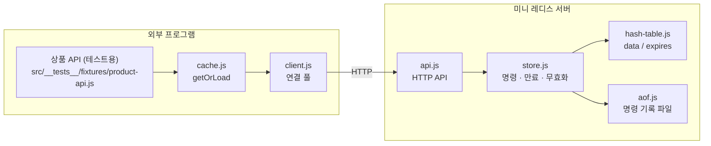
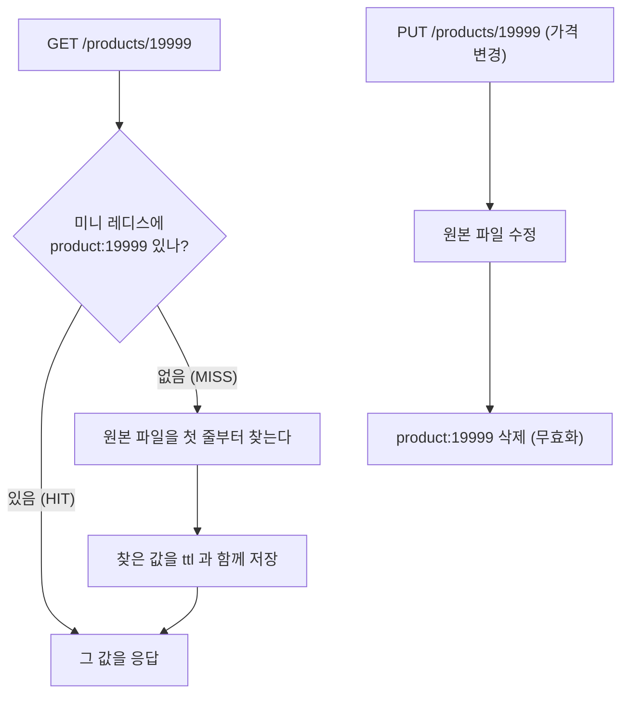

# Mini Redis
해시 테이블을 직접 구현해서 만든 키-값 저장소. HTTP API로 외부 프로그램이 사용할 수 있다.

## 0. 실행 방법
Node.js 20 이상이 필요하고, 설치할 패키지는 없다. (외부 라이브러리 0개)

서버 실행 (포트 6380, 기록 파일 `data/mini-redis.aof`)
```bash
npm start
```
테스트 (67개)
```bash
npm test
```
성능 비교
```bash
npm run bench
```

## 1. 주요 기능 (5줄 요약)
- **해시 테이블 직접 구현**: `Map` / `Object`를 쓰지 않고 버킷 배열 + 연결 리스트로 만들었다. 충돌은 분리 연결법으로, 적재율이 0.75를 넘으면 버킷을 2배로 늘려 해결한다 (`src/hash-table.js`)
- **만료(TTL)**: 키에 접근할 때 만료 시각을 확인해 지우는 지연 삭제 + 0.1초마다 조금씩 훑어 지우는 주기 삭제 (`src/store.js`)
- **무효화**: 키 하나 삭제, 접두사로 묶어 삭제(`product:` 전체), 만료 걸기, 전체 삭제
- **동시성**: 모든 명령이 스레드 하나에서 차례로 실행된다. "읽고 계산해서 쓰는" 동작은 `incr`, `set`의 `nx`처럼 명령 하나로 제공한다
- **영속성**: 데이터를 바꾼 명령을 파일 끝에 이어 쓰고(AOF), 서버를 다시 켜면 그 파일을 재생해 복구한다 (`src/aof.js`)

## 2. 구조


| 파일 | 하는 일 |
|---|---|
| `src/hash-table.js` | 해시 테이블 (`set` / `get` / `delete` / `resize` / `scan`) |
| `src/store.js` | 키-값 저장소. 해시 테이블 2개(`data`, `expires`)로 명령·만료·무효화를 처리 |
| `src/aof.js` | 명령 기록 파일에 쓰기, 재생해서 복구, 파일 줄이기 |
| `src/api.js` | 저장소를 감싼 HTTP API 서버 |
| `src/client.js` | 다른 프로그램에서 쓰는 클라이언트 (연결 풀) |
| `src/cache.js` | 캐시로 쓰는 방법 (Cache-Aside) |
| `server.js` | 서버 실행 진입점 |
| `src/__tests__/fixtures/` | 테스트·벤치용 상품 API와 원본 저장소 (미니 레디스를 캐시로 쓰는 예) |
| `bench/compare.js` | 성능 비교 |

## 3. 해시 테이블의 설계와 주요 함수
해시 테이블은 **키를 숫자로 바꿔 배열의 칸 번호로 쓰는** 자료구조다. 배열은 칸 번호만 알면 바로 꺼낼 수 있으므로, 데이터가 아무리 많아도 찾는 시간이 거의 같다.

```
buckets (capacity = 16)
 [0] null
 [1] → { key: 'user:7', value: … } → { key: 'cart:2', value: … } → null     ← 충돌: 연결 리스트로 잇는다
 [2] null
 [3] → { key: 'user:1', value: … } → null
 …
```

`set('user:1', 값)`이 실행되는 순서
1. **해시 계산** `hashString('user:1')`: 글자마다 XOR 하고 소수를 곱해(FNV-1a) 32비트 정수를 만든다. 같은 문자열은 항상 같은 숫자가 나온다
2. **버킷 번호** `해시 & (capacity - 1)`: capacity가 2의 거듭제곱이라 나머지 연산과 같은 결과가 나온다
3. **버킷 안 탐색** `findNode`: 그 버킷의 연결 리스트를 따라가며 키가 같은 노드를 찾는다
4. 있으면 값만 바꾸고, 없으면 새 노드를 리스트 **맨 앞**에 끼운다
5. **리사이즈 확인**: 노드 수가 `capacity × 0.75`를 넘으면 `resize(capacity × 2)`

| 함수 | 동작 | 평균 시간 |
|---|---|---|
| `set(key, value)` | 위 1~5 | O(1) |
| `get(key)` | 버킷 번호를 구해 연결 리스트에서 키를 찾는다 | O(1) |
| `delete(key)` | 노드를 찾아 앞 노드의 `next`를 다음 노드로 바꾼다 (머리 노드면 버킷이 다음 노드를 가리키게 한다) | O(1) |
| `resize(n)` | 새 버킷 배열을 만들고 모든 노드의 버킷 번호를 다시 계산해 옮긴다 (rehash) | O(n), 드물게 실행 |
| `scan(cursor, count)` | cursor번 버킷부터 count개쯤 읽고 다음 cursor를 돌려준다 (만료 청소용) | O(count) |

**충돌**은 서로 다른 키가 같은 버킷에 들어오는 것이다. 버킷 수가 유한하므로 피할 수 없다. 같은 버킷의 노드를 `next`로 이어 두고(분리 연결법), 찾을 때는 키를 직접 비교한다.

**리사이즈**가 없으면 데이터가 늘수록 연결 리스트가 길어져 O(n)이 된다. 적재율(노드 수 ÷ 버킷 수)을 0.75 이하로 유지하면 리스트 길이가 짧게 유지된다. 실제로 100만 개를 넣었을 때 가장 긴 연결 리스트는 6개였다.

## 4. 중점 포인트
### 동시성 문제가 생기지 않는 구조
동시성 문제는 **두 작업이 같은 데이터를 번갈아 건드릴 때** 생긴다. 예를 들어 조회수 10을 두 요청이 동시에 읽고 각각 11을 쓰면 12가 아니라 11이 된다.

이 프로젝트는 락을 쓰는 대신 **끼어들 틈을 없앴다**. 실제 Redis와 같은 방식이다.
- 저장소 명령(`store.js`)은 전부 중간에 `await`가 없는 동기 함수다. Node.js는 자바스크립트를 스레드 하나로 실행하므로, 명령 하나가 끝나야 다음 명령이 시작된다
- API 서버는 요청 본문을 다 읽은 뒤에 명령을 **함수 호출 한 번**으로 실행한다 (`api.js`의 `execute`). 요청 500개가 동시에 와도 명령은 한 줄로 서서 실행된다
- 클라이언트가 "읽고 → 계산하고 → 쓰기"를 요청 두 번으로 나눠 하면 그 사이에 다른 요청이 끼어들 수 있다. 그래서 이런 동작은 명령 하나로 제공한다: `incr`(증가), `set`의 `nx`(없을 때만 저장 = 잠금 잡기)

테스트로 확인한 것: 요청 500개가 동시에 같은 키를 `incr` → 정확히 500, 요청 100개가 동시에 `nx`로 저장 → 성공은 1개뿐.

### 보관 기간이 만료된 값을 요청받았을 때
만료 시각은 `expires` 해시 테이블에 `key → 만료 시각`으로 따로 저장한다.

| 방식 | 언제 | 하는 일 |
|---|---|---|
| 지연 삭제 | 키에 접근할 때마다 (`get`, `exists`, `incr` 등) | 만료 시각이 지났으면 그 자리에서 지우고 "없는 키"로 답한다 (HTTP 404) |
| 주기 삭제 | 0.1초마다 (`sweepExpired`) | `expires` 테이블을 20개쯤 훑어 만료된 키를 지운다. 훑은 것의 1/4 넘게 만료돼 있었으면 한 번 더 훑는다 |

지연 삭제만 있으면 아무도 다시 찾지 않는 키가 메모리에 계속 남는다. 주기 삭제만 있으면 청소 전까지 만료된 값이 조회된다. 둘을 같이 써서 **만료된 값은 절대 돌려주지 않으면서** 메모리도 회수한다. 주기 삭제가 전체를 한 번에 훑지 않고 조금씩 훑는 이유는, 훑는 동안 다른 명령이 기다려야 하기 때문이다.

### 외부에서 쓰기 쉬운 API
HTTP + JSON이라 어떤 언어에서든 쓸 수 있다. ttl 단위는 ms.

| 요청 | 하는 일 | 응답 |
|---|---|---|
| `GET /keys/:key` | 조회 | `200 { key, value, ttl }` / `404` |
| `PUT /keys/:key` ← `{ value, ttl?, nx?, xx? }` | 저장 | `200 { ok: true }` / `409` (조건 불일치) |
| `DELETE /keys/:key` | 삭제 | `200 { deleted }` |
| `POST /keys/:key/incr` ← `{ by? }` | 정수 증가 | `200 { value }` |
| `POST /keys/:key/expire` ← `{ ttl }` | 만료 걸기 | `200` / `404` |
| `DELETE /keys/:key/expire` | 만료 없애기 | `200 { ok }` |
| `GET /keys?prefix=` | 키 목록 | `200 { keys }` |
| `DELETE /keys?prefix=product:` | 묶음 무효화 | `200 { deleted }` |
| `POST /flush` | 전체 삭제 | `200 { deleted }` |
| `GET /info` | 상태 (키 수, 적중률, 해시 테이블 상태) | `200` |

Node.js에서는 `src/client.js`를 쓰면 함수 호출처럼 쓸 수 있다.
```js
const redis = createClient('http://127.0.0.1:6380');
await redis.set('user:1', { name: '철수' }, { ttl: 60_000 });
await redis.get('user:1');   // { name: '철수' }, 없거나 만료됐으면 null
```

### 저장된 데이터를 무효화하는 방식
캐시의 값은 원본의 복사본이라, 원본이 바뀌면 틀린 값이 된다. 무효화 방법은 네 가지다.

| 방법 | 명령 | 쓰는 경우 |
|---|---|---|
| 시간으로 | `set`의 `ttl`, `expire` | 조금 오래된 값이어도 괜찮을 때. 지우는 것을 잊어도 언젠가 사라진다 |
| 키 하나 | `del(key)` | 원본 하나가 바뀌었을 때. 상품 API는 가격을 바꾸면 `product:<id>`를 지운다 |
| 접두사로 묶어서 | `delByPrefix('product:')` | 관련된 값 전체가 바뀌었을 때. 키 이름을 `종류:id`로 지은 이유다 |
| 전부 | `flushAll()` | 배포 직후 등 |

상품 API는 **TTL + 변경 시 삭제**를 같이 쓴다. 변경 시 삭제가 실패하더라도 TTL이 지나면 옛 값이 사라진다.

### 서버가 다운돼도 데이터를 지키는 방식
메모리의 데이터는 프로세스가 죽으면 사라진다. 그래서 **데이터를 바꾼 명령을 한 줄씩 파일 끝에 이어 쓴다** (AOF, Append Only File).

```
{"op":"set","key":"n","value":1,"expireAt":null}
{"op":"set","key":"hello","value":"world","expireAt":null}
{"op":"del","key":"hello"}
```

- **복구**: 서버를 켜면 파일을 첫 줄부터 읽어 같은 명령을 다시 실행한다. 꺼지기 직전 상태가 된다
- **만료는 절대 시각으로 기록**: "60초 뒤"로 적으면 재시작할 때마다 60초가 다시 시작된다. 만료 시각을 적어 두면 꺼져 있던 시간도 보관 기간에 포함된다
- **fsync 정책**: `write`만 하면 내용이 운영체제 버퍼에 머물 수 있다. `always`는 명령마다 디스크에 쓰게 하고(가장 안전, 가장 느림), `everysec`(기본값)은 1초마다 쓴다. 죽어도 최대 1초 분량만 잃는다
- **잘린 줄**: 쓰는 도중 죽으면 마지막 줄이 잘릴 수 있다. 해석되지 않는 줄을 만나면 그 앞까지만 복구한다
- **파일 줄이기**: 같은 키를 1000번 바꾸면 1000줄이 쌓인다. 재시작할 때 살아 있는 키만 새 파일에 쓰고 이름을 바꿔 교체한다. 새 파일을 다 쓴 뒤에 교체하므로 도중에 죽어도 원래 파일이 남는다

스냅샷(전체를 주기적으로 저장) 대신 AOF를 고른 이유는, 스냅샷은 마지막 저장 이후의 변경을 모두 잃지만 AOF는 최대 1초 분량만 잃기 때문이다.

실제로 확인한 것: 값을 쓰고 프로세스를 강제 종료(`taskkill /F`, 테스트에서는 `SIGKILL`)한 뒤 다시 켜서 값이 남아 있는 것을 확인했다.

## 5. 상품 API가 미니 레디스를 캐시로 쓰는 흐름


1. **조회 (MISS)**: 캐시에 없으면 원본을 읽는다. 원본은 상품 2만 개가 든 파일이고 인덱스가 없어서 첫 줄부터 찾아야 한다
2. **저장**: 읽은 값을 `product:19999` 키로 미니 레디스에 넣는다 (ttl 지정)
3. **조회 (HIT)**: 다음 요청부터는 미니 레디스의 값을 그대로 응답한다. 원본을 읽지 않는다
4. **무효화**: 가격을 바꾸면 원본을 수정한 뒤 캐시의 키를 지운다. 다음 조회는 다시 MISS가 되어 새 값을 읽는다

`src/cache.js`가 추가로 처리하는 두 가지
- **동시에 놓친 요청 합치기**: 캐시에 없는 같은 상품을 20명이 동시에 요청하면 원본을 20번 읽게 된다. 먼저 시작한 조회 하나를 나머지가 함께 기다리게 해서 원본은 1번만 읽는다
- **캐시 서버가 죽었을 때**: 캐시 오류는 무시하고 원본에서 읽어 응답한다. 캐시가 없어도 느려질 뿐 서비스는 동작한다

## 6. 성능 비교 (미니 레디스 사용 / 미사용)
`npm run bench`로 실제 실행한 결과다. (Windows 11, Node.js 26, 2026-11-12 측정. 실행할 때마다 조금씩 달라진다)

상품 2만 개, 인기 상품 100개를 2,000번 조회 (동시 20개)

| 항목 | 미니 레디스 없음 | 미니 레디스 사용 | 차이 |
|---|---:|---:|---:|
| 전체 걸린 시간 | 10,220 ms | 948 ms | 10.8배 빠름 |
| 초당 처리 요청 | 196 건 | 2,110 건 | 10.8배 |
| 평균 응답 시간 | 102.12 ms | 9.46 ms | 10.8배 빠름 |
| 중간값 (p50) | 103.38 ms | 4.57 ms | |
| 느린 5% (p95) | 128.99 ms | 38.59 ms | |
| 원본 파일을 읽은 횟수 | 2,000 번 | 100 번 | |

캐시를 쓰면 원본은 상품마다 처음 한 번씩, 100번만 읽는다. p95가 p50보다 훨씬 큰 것은 그 100번의 MISS가 포함돼 있기 때문이다. 모든 서버가 한 프로세스 안에서 돌았으므로 절대 수치보다 두 경우의 차이를 보는 결과다.

저장소 자체 속도 (HTTP를 거치지 않고 직접 호출, 키 100만 개)

| 명령 | 걸린 시간 | 초당 처리 |
|---|---:|---:|
| `set` | 447 ms | 약 224만 건 |
| `get` | 224 ms | 약 447만 건 |
| `del` | 304 ms | 약 329만 건 |

100만 개를 넣은 뒤 해시 테이블 상태: 버킷 2,097,152개, 적재율 0.48, 가장 긴 연결 리스트 6개.

## 7. 테스트
`node:test`만 사용했다. 총 67개.

| 파일 (`src/__tests__/`) | 종류 | 검증하는 것 |
|---|---|---|
| `hash-table.test.js` | 단위 | 저장·조회·삭제, 충돌(같은 버킷의 머리 / 중간 / 끝 노드 삭제), 리사이즈, 10만 개 |
| `store.test.js` | 단위 | 저장·조회·삭제, `nx` / `xx`, `incr`, 지연 삭제, 주기 삭제, 무효화, 잘못된 인자 |
| `aof.test.js` | 단위 | 재시작 복구, 강제 종료(`SIGKILL`) 뒤 복구, 꺼져 있던 시간과 만료, 잘린 줄, 파일 줄이기 |
| `api.test.js` | 기능 | 서버를 실제로 띄워 HTTP로 저장·조회·삭제, 만료, 동시 요청 500개, 잘못된 요청 |
| `cache-api.test.js` | 기능 | 상품 API의 응답을 미니 레디스에 저장해 활용: MISS → HIT, 만료, 무효화, 동시 조회, 캐시 서버 장애 |

엣지 케이스로 확인한 것: 빈 키 / 너무 긴 키 / 문자열이 아닌 키, 값 없음, 잘못된 ttl(0, 음수, 문자열), 한글·공백·`/`·`?`·`%`가 들어간 키, `__proto__` 같은 키, 깨진 JSON, 1MB 넘는 본문, 없는 경로와 메서드, 만료된 키에 대한 모든 명령, 덮어쓸 때의 만료 처리, 요청 수백 개가 한꺼번에 연결할 때(클라이언트 연결 풀).

## 8. 한계와 실제 Redis와의 차이
| 항목 | 이 구현 | 실제 Redis |
|---|---|---|
| 자료형 | 키 하나에 JSON 값 하나 | 문자열, 리스트, 해시, 셋, 정렬된 셋 등 |
| 통신 | HTTP + JSON | 전용 프로토콜(RESP), 연결 하나로 명령을 연달아 보냄 |
| 리사이즈 | 한 번에 전부 옮긴다 (그 순간 다른 명령이 기다림) | 두 테이블을 두고 조금씩 옮긴다 (점진적 rehash) |
| 메모리 한도 | 없음 | 한도를 넘으면 오래 안 쓴 키부터 지운다 (LRU 등) |
| 영속성 | AOF + 재시작 시 줄이기 | AOF + RDB 스냅샷, 실행 중 백그라운드로 줄이기 |
| 여러 대 | 서버 1대 | 복제, 클러스터 |
| 없는 값 캐시 | 하지 않음 (없는 상품을 계속 조회하면 매번 원본을 읽는다) | 애플리케이션이 직접 처리 |
